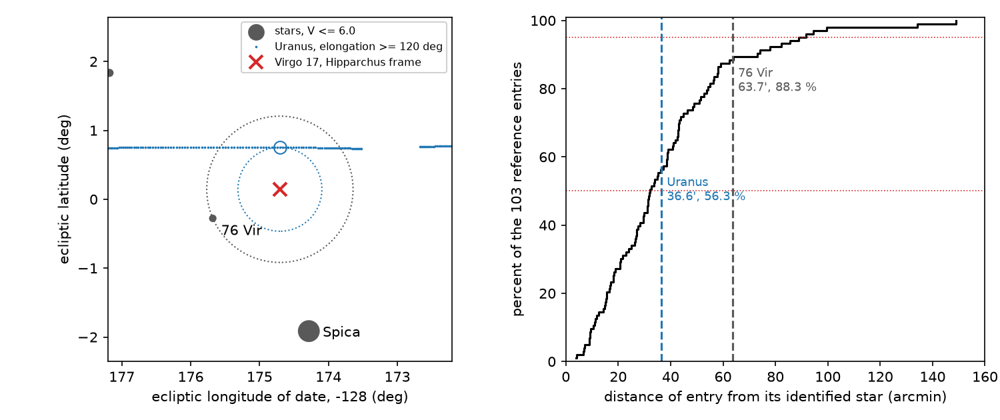

# Is Almagest Virgo 17 Uranus seen by Hipparchus? A pre-registered position test

Uranus is just bright enough to see with the unaided eye on a dark night. It was recognised as a planet only in 1781. In 1988 K. P. Hertzog proposed that one faint "star" in Ptolemy's star catalogue, the 17th star of Virgo, is really Uranus, seen by Hipparchus in about 128 BC. The usual identification of this entry is the star 76 Virginis. In 2020 N. M. Swerdlow wrote that he does not know how to decide the question.

We tested the proposal by position only. Ptolemy's catalogue has errors of about half a degree for faint stars. So the question is not "which object is closest" but "which distance is normal for this catalogue". We wrote down the test and its decision rule in git before we computed any distance. Then we measured the distance from the entry to Uranus and to the nearest real star, and compared both with the errors that the catalogue makes for 103 faint stars with secure identifications.

Uranus passes 36.6 arcminutes from the entry. That is an ordinary error for the catalogue (56th percentile). The star 76 Vir is 63.7 arcminutes away. That is a large error (88th percentile), but not beyond the 95th percentile. The pre-registered rule needed the star beyond the 95th percentile to support Hertzog, so the result is **inconclusive**. In a placebo, about one in five real catalogue stars that lie on the Uranus track match it as well. Uranus also passes equally close in Ptolemy's own time. Position alone does not decide the question.



Public data; not yet reviewed by experts.

[Read the paper](paper/paper.pdf) · [LaTeX source](paper/paper.tex) · [Pre-registered protocol](PROTOCOL.md) · [Numbers and their sources](NUMBERS.md)

## Abstract

K. P. Hertzog (1988) proposed that the 17th star of Virgo in Ptolemy's star catalogue (Baily no. 513; longitude Virgo 27 1/4°, latitude +0 1/6°, magnitude 6), usually identified with 76 Virginis, is the planet Uranus, observed by Hipparchus near 25 March -127. N. M. Swerdlow (2020) wrote that he does not know how to decide the question. We tested the identification by position only, with a protocol that we committed to git before we computed any distance. We moved the entry into the frame of Hipparchus with the median offset of 266 securely identified zodiacal entries. We then compared two distances with the errors of the catalogue itself: the distance from the entry to the nearest real star with V ≤ 6.0, and the smallest distance from the entry to Uranus on the nights of 149-127 BC with solar elongation of at least 120°. The reference errors are those of 103 faint identified entries (median 32.1', 95th percentile 88.5'). The nearest star is 76 Vir at 63.7', at the 88.3rd percentile. Uranus passes 36.6' from the entry on 128 BC April 7, at the 56.3rd percentile. Support for Hertzog required the star above the 95th percentile and Uranus at or below the 50th. Neither the support rule nor the refutation rule is met, so the registered result is inconclusive. In a registered placebo, 6 of 108 identified entries near the ecliptic come as close to the Uranus track; 6 of the 31 entries inside the longitude range of the track do. Uranus passes equally close (37.7') in Ptolemy's own time, so position alone also does not separate a Hipparchan from a Ptolemaic origin. An independent recomputation with another precession model gives the same verdict.

This work has not yet been reviewed by experts. The analysis, the code and the text were produced by AI models (from Anthropic and OpenAI), working under the author's direction.

## Check it

Run all commands in this section from this folder (`cd results/almagest-virgo-uranus` from the repository root). You need Python 3.13, `curl`, and network access to `vizier.cfa.harvard.edu` and `ssd.jpl.nasa.gov`.

```sh
bash checks/ci.sh
```

The script installs the pinned packages of `checks/requirements.txt` and runs `checks/rerun.py`. That script downloads the Ptolemy catalogue, the Hipparcos stars with V < 6.6 and two Uranus ephemeris files again (about 2.5 MB), reruns the registered test, the exploratory numbers and the post hoc limits, and compares 120 values with `data/expected.json`. It ends with `120/120 values match` and `ci: all checks passed`. Run time on a Steam Deck (one core, fresh virtual environment): 26 to 35 s wall time in two runs, including the package installation. [More detail](checks/README.md).

## Credits

Ptolemy's catalogue with modern identifications: F. Verbunt and R. H. van Gent (2012), through VizieR (CDS, Strasbourg). Star positions: the Hipparcos catalogue (ESA 1997). Ephemeris: JPL Horizons, DE441. The open question: N. M. Swerdlow (2020), open access. [Data sources and licences](THIRD_PARTY.md). Apache-2.0 (see the repository's LICENSE), except the third-party material listed in [THIRD_PARTY.md](THIRD_PARTY.md).

## Cite

```bibtex
@misc{WuAlmagestVirgoUranus2026,
  author       = {Wu, Qianghao},
  title        = {{Is Almagest Virgo 17 Uranus seen by Hipparchus? A pre-registered position test}},
  year         = {2026},
  howpublished = {\url{https://github.com/KenWuqianghao/kenwu-lab/tree/main/results/almagest-virgo-uranus}}
}
```
