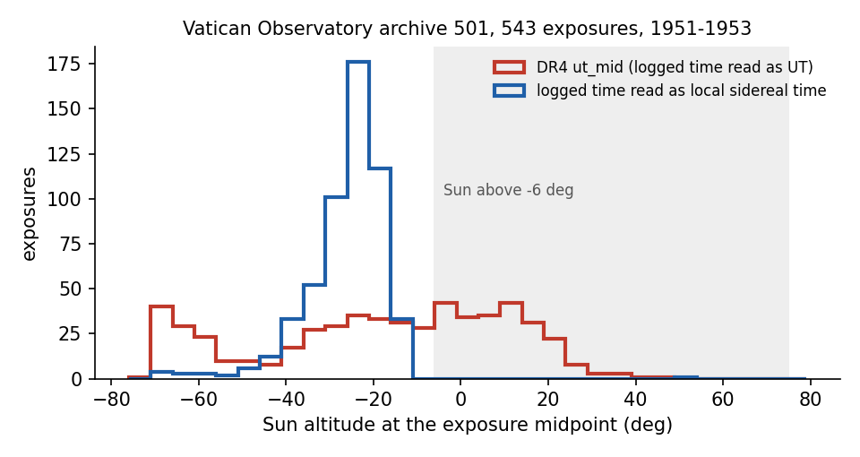

# Swapped site coordinates and a sidereal-time error in the APPLAUSE DR4 plate metadata

APPLAUSE is a public archive of scanned photographic plates from European observatories, mostly from Hamburg, Bamberg and Potsdam. For each plate it gives the place of the telescope and the time of each exposure. Astronomers use these values to find where a star or a planet was in the sky, how high it was, and whether an old plate shows an object that was found later.

We found two errors in Data Release 4 (DR4).

**Swapped coordinates.** Four site records have the longitude and the latitude exchanged: Bamberg (18,681 plates), two sites near Davos (93 and 38 plates) and San Miguel in Argentina (870 plates). DR4 puts Bamberg at longitude 49.88 and latitude 10.89; the real values are the reverse. A test that we wrote down before we computed anything shows that the exposure times were not computed from the wrong longitude: at Bamberg and San Miguel, the DR4 times fall at night at the real sites. But any altitude or air mass that a user computes from the recorded coordinates is wrong.

**Vatican times.** In the Vatican Observatory archive (544 plates, Castel Gandolfo, 1951-1953), 40.8% of the DR4 exposure times are in daylight or twilight, although the targets are stars. DR4 copied the logged time into the UT column without change. The logged times are local sidereal time (star time). If we read them that way, 0.2% of the exposures are in daylight or twilight. All 543 dated exposures have wrong times; the median error is 4.9 hours. We give a corrected time for each exposure in [data/vatican_corrected.csv](data/vatican_corrected.csv).



Public data; not yet reviewed by experts.

[Read the paper](paper/paper.pdf) · [LaTeX source](paper/paper.tex) · [Pre-registered protocol](PROTOCOL.md) · [Numbers and their sources](NUMBERS.md)

## Abstract

APPLAUSE Data Release 4 (DR4) is a public archive with metadata for 94,090 photographic plates, mostly from Hamburg, Bamberg and Potsdam. Its schema defines `site_longitude` as the east longitude of the site, `site_latitude` as its latitude, and `ut_mid` as the UT of the exposure midpoint. We report two errors in these columns. (1) Four site records have the longitude and the latitude exchanged: Bamberg (18,681 plates), Muottas Muragl (93), Hotel Schatzalp in Davos (38) and San Miguel, Argentina (870). A test that we registered in advance shows that the exchange did not enter `ut_mid` at Bamberg (n = 18,947 timed exposures) or San Miguel (n = 858): at the true sites, the Sun is above -6° at 0.13% and 0.0% of the midpoints, and the time shift that the exchange implies raises these fractions to 10.7% and 3.5%. Users who take the recorded coordinates get wrong altitudes; for example, 6.0% of the archive-208 exposures then appear to be in twilight or daylight. (2) A negative control found that in the Vatican Observatory archive (archive 501, Castel Gandolfo), 40.8% of the 544 DR4 midpoints have the Sun above -6°. DR4 copies the logged time into `ut_mid` without change. If the logged time is read as local sidereal time, 0.2% of the midpoints are in daylight or twilight, and the plate centre is below 20° altitude for 0.7% of exposures, against 51.3% for the DR4 midpoints. When the logged times are permuted among exposures, the same reading gives on average 41.6% in daylight or twilight and 9.3% below 20°. The sidereal reading changes all 543 dated midpoints (1951 May 19 to 1953 Dec 26), also those that DR4 puts at night, and leaves one of them in daylight; the median correction is 4.9 h. We give a corrected midpoint for each exposure. The midpoints of Potsdam archives 4 and 5 are also often in daylight; we did not find the cause.

This work has not yet been reviewed by experts. The computations and the text were produced by AI models (from Anthropic and OpenAI), working under the author's direction.

## Check it

Run all commands in this section from this folder (`cd results/applause-site-time-errors` from the repository root). You need Python 3.13, `curl` and network access to `https://www.plate-archive.org`. No package is needed.

Rerun everything from the public data. The script downloads the DR4 metadata (about 90 MB), reruns the analysis, and compares 70 values with `data/expected.json` and the per-exposure Vatican table with `data/vatican_corrected.csv`:

```sh
bash checks/ci.sh
```

It ends with `71 of 71 checks match`, `ALL MATCH` and `ci: all checks passed`. Run time on a Steam Deck (one core): 76 s, including the download (network speed can change this). [More detail](checks/README.md).

## Credits

The plates, scans and metadata come from APPLAUSE DR4 (Leibniz Institute for Astrophysics Potsdam, Dr. Remeis-Sternwarte Bamberg, Hamburger Sternwarte, Tartu Observatory, Thüringer Landessternwarte Tautenburg and the Vatican Observatory). This work has made use of data from APPLAUSE Data Release 4. [Data sources and licences](THIRD_PARTY.md). Apache-2.0 (see the repository's LICENSE), except the third-party material listed in [THIRD_PARTY.md](THIRD_PARTY.md).

## Cite

```bibtex
@misc{WuApplauseSiteTimeErrors2026,
  author       = {Wu, Qianghao},
  title        = {{Swapped site coordinates and a sidereal-time error in the APPLAUSE DR4 plate metadata}},
  year         = {2026},
  howpublished = {\url{https://github.com/KenWuqianghao/kenwu-lab/tree/main/results/applause-site-time-errors}}
}
```
