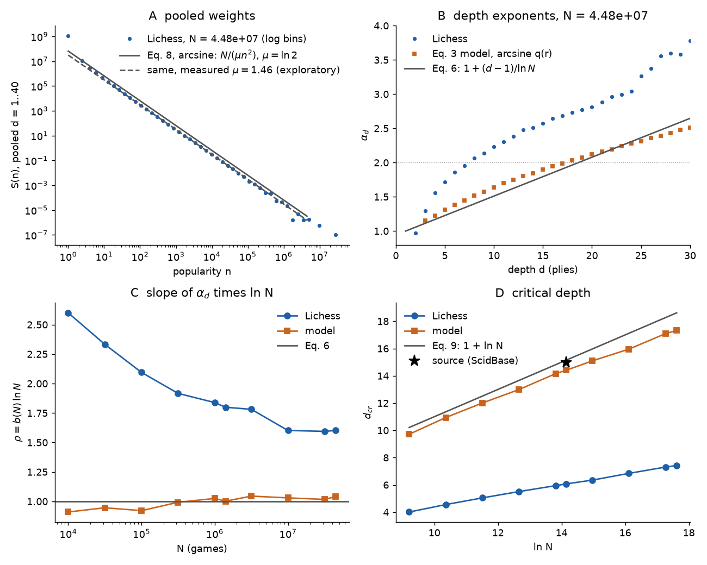

# The Zipf law of chess openings on 44.8 million Lichess games: the exponent 2 holds, the finite-size laws do not

Count how many games in a database start with the same first few moves. Most move sequences are rare and a few are very common. In 2009, Blasius and Tönjes found that these counts follow a Zipf law with exponent 2 in a database of 1.4 million games. Their theory also says how the law changes when the database grows. Nobody had tested that part with a larger database. We tested it on 44.8 million games from the public Lichess database, with a test plan that was fixed before the data was analysed.

The exponent 2 holds: we measure 2.09. The predictions about database size fail. The exponent also depends on the depth, that is, the number of half-moves in the sequence. The theory says that the depth where this exponent passes 2 grows by one half-move for each factor of e (about 2.7) in the database size, and is about 18 half-moves for this database. On Lichess it grows by 0.4 half-moves for each factor of e and is 7.4 half-moves. Both failures repeat for fast and slow games, for low and high ratings, and for 2013–2014 and 2015.



*A: the counts of all move sequences, with the theory line. B: the exponent at each depth, for Lichess, the authors' model and their formula. C and D: two quantities that the theory predicts as a function of database size; Lichess (blue) does not follow the model (orange).*

Public data; not yet reviewed by experts.

[Read the paper](paper/paper.pdf) · [LaTeX source](paper/paper.tex)

## Abstract

Blasius and Tönjes (2009) found that the weights of opening lines in a database of 1.4 million chess games follow a Zipf law with the universal exponent α = 2. Their theory also predicts how the database size N changes the depth-dependent exponents: the slope of α_d against the depth d is 1/ln N, and α_d crosses 2 at d_cr = 1 + ln N. The source tested these finite-size laws at one value of N only. We tested all three predictions out of sample on 44,832,865 rated games from the public Lichess database (2013–2015), with a pre-registered protocol, random subsets from 10^4 games to the full set, and the authors' own branching model as a known-answer control. The pooled exponent is 2.086 at the full N, inside the pre-registered band 2 ± 0.10. The finite-size laws fail. The fitted slope falls with N as (ln N)^−1.76, while the same estimator applied to the model gives (ln N)^−0.79. The exponent α_d crosses 2 at depth 7.4, while the model gives 17.3. At the source's own sample size the crossing depth is 6.1, against the reported value of about 15. Both failures repeat in every speed, rating and period stratum. A placebo that shuffles moves between games also gives a pooled exponent near 2, so the value 2 alone is not specific to chess. On Lichess, α_d is concave in d: its steps are larger than 1/ln N only in the first 7 or 8 plies. These are statements about online play in 2013–2015; we did not re-test the source's database. This work has not yet been reviewed by experts. The computations and the text were produced by AI models (from Anthropic and OpenAI), working under the author's direction.

## Check it

Compare the committed outputs with the 1950 numbers of the paper (about 1 s). Python 3.13:

```sh
python3 -m venv .venv
.venv/bin/python -m pip install -r checks/requirements.txt
.venv/bin/python -I checks/test_counting.py
.venv/bin/python -I checks/rerun.py --compare-only data/results.json data/explore.json data/robustness.json
```

The first check prints `PASS` after about 6 s. The second prints `1950/1950 numbers match` and `PASS`.

Rebuild every number from the raw Lichess files. This needs `curl`, `zstd` and `shasum`, about 8 GB of free disk and 2 GB of RAM. It downloads 6.9 GB.

```sh
bash checks/ci.sh
```

It ends with `1950/1950 numbers match` and `PASS`. On an M1 Pro with 2 parallel workers and the 36 files already downloaded, the full run took 12 minutes (2026-11-26). The download took about 32 minutes at 10 MB/s in an earlier run. To reuse files that you already downloaded, set `CHESSZIPF_RAW` to their folder; the script checks each SHA-256. Each run starts from an empty work folder. Details: [checks/README.md](checks/README.md).

## Credits

Bernd Blasius and Ralf Tönjes stated the law and the finite-size theory that we tested. The Lichess team and its players made the games public under CC0. The tests use the `powerlaw` package of Alstott, Bullmore and Plenz. Data sources and licenses: [THIRD_PARTY.md](THIRD_PARTY.md). The source of each number in the paper: [NUMBERS.md](NUMBERS.md).

## Cite

```bibtex
@misc{WuChessOpeningZipfLichess2026,
  author       = {Wu, Qianghao},
  title        = {{The Zipf law of chess openings on 44.8 million Lichess games: the exponent 2 holds, the finite-size laws do not}},
  year         = {2026},
  howpublished = {\url{https://github.com/KenWuqianghao/kenwu-lab/tree/main/results/chess-opening-zipf-lichess}}
}
```
