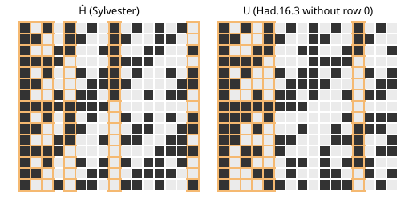

# The Sylvester–Hadamard game matrix does not have the largest boosting gap

[Boosting](https://en.wikipedia.org/wiki/Boosting_(machine_learning)) combines many weak classifiers into a strong one. One way to study it is as a game: the rows of a ±1 matrix are the training examples, the columns are the classifiers, and after *t* rounds the algorithm has seen *t* columns. The value of those *t* columns is the best margin that a weighted vote of them can reach. A matrix whose *t*-column values stay low for a long time proves that boosting cannot be fast.

Nie, Warmuth, Vishwanathan and Zhang ([COLT 2013](https://proceedings.mlr.press/v30/Nie13.html)) built such matrices from [Hadamard matrices](https://en.wikipedia.org/wiki/Hadamard_matrix): take the *n* × *n* Hadamard matrix, delete its first row, and call the result Ĥ. Their Conjecture 2 says that Ĥ is the worst case: no other (*n*−1) × *n* matrix of ±1 entries with game value 0 has a lower best value at any number *t* of columns.

We show that the conjecture is false for the Sylvester Hadamard matrix of order 16. At *t* = 6, the best 6 columns of Ĥ reach a value of at least −1/3. The matrix *U* below, which is another Hadamard matrix (Had.16.3 in [Sloane's library](http://neilsloane.com/hadamard/)) with its all-ones row deleted, reaches only −3/7 with its best 6 columns.



Proved in Lean; not yet reviewed by experts.

The proofs, the code and the text were produced by AI models (from Anthropic and OpenAI), working under the author's direction.

[Read the paper](paper/paper.pdf) · [LaTeX source](paper/paper.tex) · [Lean proof](lean/Solution.lean) · [Lean statement](lean/Challenge.lean)

## Abstract

Nie, Warmuth, Vishwanathan and Zhang (COLT 2013) view boosting as a zero-sum game and build game matrices from Hadamard matrices. Let Ĥ be the *n* × *n* Hadamard matrix with its first row removed. Their Conjecture 2 states that Ĥ gives the largest gaps among all (*n*−1) × *n* matrices with entries ±1 and game value 0: for every such matrix *U* and every 1 ≤ *t* ≤ *n*, the best *t*-column sub-matrix of Ĥ has a game value at most that of the best *t*-column sub-matrix of *U*. We show that the conjecture is false when *H* is the Sylvester Hadamard matrix of order *n* = 16. For *t* = 6, the matrix *U* obtained from the Hadamard matrix Had.16.3 of Sloane's library by deleting its all-ones row satisfies max val_D(*U*₆) = −3/7, while max val_D(Ĥ₆) ≥ −1/3. The upper bound for *U* comes from 8008 exact dual certificates, one for each set of 6 columns. Lean 4 with Mathlib checks the full statement from the definitions, with kernel evaluation of the certificates and only the standard axioms. Two exact checkers in Python also accept the certificates. The counterexample does not refute the weaker reading in which Ĥ can come from any Hadamard matrix of order *n*. This work has not yet been reviewed by experts. The computations, the proofs and the text were produced by AI models (from Anthropic and OpenAI), working under the author's direction.

## Check it

From this folder, with Python 3.10 or later:

```sh
python3 -I checks/check.py checks/certificate.json
python3 -I checks/check_extra.py checks/certificate.json checks/had.16.3.txt
```

Both scripts use only the standard library and exact rational arithmetic. The first checks the 8008 certificates and the Sylvester witness in about 3 seconds. The second checks that *U* is Had.16.3 without row 0, the equality case 3/7, and the hand formula for the Sylvester row sums, in less than a second.

The full check, as CI runs it (installs NumPy and SciPy, about 1 minute):

```sh
bash checks/ci.sh
```

The Lean proof compiles against Mathlib v4.36.0 (Lean v4.36.0):

```sh
lake env lean lean/Solution.lean
```

The kernel evaluation of the certificates takes about 20 minutes on one core of a Steam Deck and needs up to about 6 GB of memory. [checks/README.md](checks/README.md) describes each step.

## Credits

Jiazhong Nie, Manfred K. Warmuth, S. V. N. Vishwanathan and Xinhua Zhang posed the conjecture in [Open Problem: Lower bounds for Boosting with Hadamard Matrices](https://proceedings.mlr.press/v30/Nie13.html), COLT 2013, PMLR 30:1076–1079. Allan Grønlund, Kasper Green Larsen and Alexander Mathiasen refuted their Conjecture 1 in [Optimal Minimal Margin Maximization with Boosting](https://arxiv.org/abs/1901.10789). The matrix *U* comes from N. J. A. Sloane's [Library of Hadamard Matrices](http://neilsloane.com/hadamard/) (see [THIRD_PARTY.md](THIRD_PARTY.md)). The dual vectors were found with [HiGHS](https://highs.dev/) through [SciPy](https://scipy.org/). The formal proof uses [Lean 4](https://lean-lang.org/) and [Mathlib](https://github.com/leanprover-community/mathlib4). Apache-2.0 (see the repository's LICENSE).

## Cite

```bibtex
@misc{WuColtHadamardBoostingGap2026,
  author = {Wu, Qianghao},
  title = {{The Sylvester--Hadamard game matrix does not have the largest boosting gap: a counterexample to Conjecture 2 of Nie, Warmuth, Vishwanathan and Zhang}},
  year = {2026},
  howpublished = {\url{https://github.com/KenWuqianghao/kenwu-lab/tree/main/results/colt-hadamard-boosting-gap}}
}
```

Archived on Zenodo: [doi:10.5281/zenodo.24613532](https://doi.org/10.5281/zenodo.24613532)
