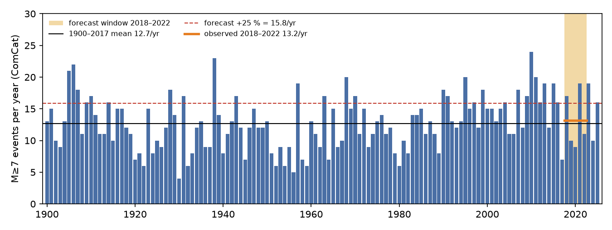

# An inconclusive score of the 2017 Earth-rotation forecast of more global M≥7 earthquakes

In October 2017, Roger Bilham and Rebecca Bendick noticed that the rotation of the Earth had slowed down a little since 2011. In the past century, such slowdowns came 5–6 years before periods with 25–30% more large earthquakes (magnitude 7 or more). So they forecast more large earthquakes worldwide for at least five years from 2018. The press reported 17 to 20 such earthquakes per year.

The five years are over. We counted the earthquakes in the public USGS catalog with a test that we wrote down and committed before we counted.

The years 2018–2022 had 66 earthquakes of magnitude 7 or more, 13.2 per year. The 1900–2017 average is 12.7 per year. So the rate was only 4% above average. But five years of earthquakes vary a lot by chance. The data cannot reject "no increase", and they cannot reject "+25%". The verdict of the pre-registered test is **inconclusive**. A count of 61 or fewer would have refuted the forecast. A count of 80 or more would have supported it.

We also tested the five-year delay itself on 2018–2025. The years that the delay marks as active were not more active (rate ratio 0.98). This test has only 17% power, so it says little.



*Annual number of M≥7 earthquakes in ComCat. Black: 1900–2017 mean. Red dashed: the forecast +25% level. Orange: the observed 2018–2022 mean. Shaded: the forecast window.*

Public data; computer-assisted; not yet reviewed by experts.

[Read the paper](paper/paper.pdf) · [LaTeX source](paper/paper.tex) · [Pre-registered protocol](PROTOCOL.md)

## Abstract

In 2017, Bilham and Bendick forecast that a slowing of Earth's rotation that began in 2011 would bring a period of at least five years with more global earthquakes of magnitude 7 or more. Their abstract gives a 25–30% increase in such periods. We pre-registered a test of the forecast against the USGS ComCat catalog, and we disclose the counts that were seen before the protocol. ComCat lists 66 M≥7 events in 2018–2022, or 13.2 per year. The 1900–2017 mean is 12.68 per year, so the observed rate is 1.04 times this baseline (95% interval 0.78–1.39). Under a negative binomial model of annual counts, the +25% level is not rejected (p = 0.115), and no increase above the baseline is shown (p = 0.40). The pre-registered verdict is inconclusive: one five-year window cannot separate no increase from an increase of 25%. Under this rule, 61 events or fewer would have refuted the forecast, and 80 or more would have supported it. A held-out test of the five-year lag between rotation slowing and seismicity, on 2018–2025, gives a rate ratio of 0.98 (permutation p = 0.61). This test has a power of only 17% for a 25% effect, so it gives little information. In 1900–2017, the same lag statistic is largest at lags of 6–8 years (rate ratio about 1.1). Over all ten lags, this maximum is at the 97th percentile of a circular-shift null for the raw catalog and at the 86th percentile for a declustered catalog. These are tests of association in count data. This work has not yet been reviewed by experts. The computations, the code and the text were produced by AI models (from Anthropic and OpenAI), working under the author's direction.

## Check it

With Python 3.13 and an internet connection, from this folder:

```sh
bash checks/ci.sh
```

The script installs numpy and scipy (pinned in `checks/requirements.txt`), downloads the ComCat catalog of M≥7 events for 1900–2025 and the EOP C02 and C04 length-of-day series (about 5 MB), recomputes the study, and compares 647 numbers with `data/expected.json`. It prints `checked 647 values, 0 mismatches` and exits 0. On an M1 Pro laptop the run took 22 s (2026-11-25). See [checks/README.md](checks/README.md).

ComCat can revise events, and C02 is updated each month. If a later download changes a number, the script prints the difference and exits 1.

## Credits

Roger Bilham and Rebecca Bendick made the forecast and published the method. The U.S. Geological Survey publishes ComCat. The Paris Observatory (C. Bizouard) publishes the EOP C02 series, based before 1955 on Jordi et al. (1994). The IERS publishes the EOP 20 C04 series. Data sources and terms are in [THIRD_PARTY.md](THIRD_PARTY.md).

## Cite

```bibtex
@misc{WuEarthRotationQuakeForecast2026,
  author = {Wu, Qianghao},
  title  = {{An inconclusive score of the 2017 Earth-rotation forecast of more global M$\ge$7 earthquakes}},
  year   = {2026},
  howpublished = {\url{https://github.com/KenWuqianghao/kenwu-lab/tree/main/results/earth-rotation-quake-forecast}}
}
```
