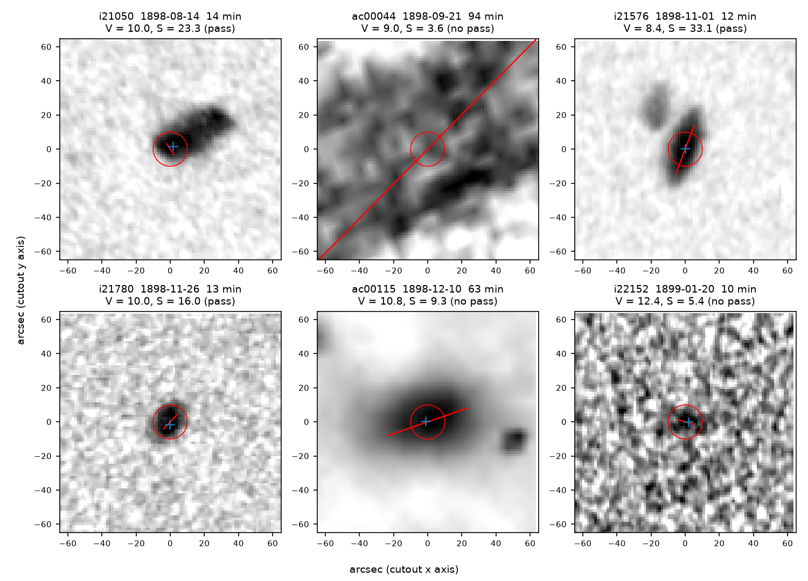

# (1036) Ganymed on Harvard plates of 1898, 26 years before its discovery, and a candidate image of (624) Hektor from 1901

(1036) Ganymed is the largest known near-Earth asteroid. Walter Baade discovered it in 1924. Harvard College Observatory keeps a large collection of photographic glass plates of the sky. The DASCH project scanned these plates and made the scans public. An asteroid that was on the sky before its discovery can be on these plates. An image of this kind is called a *precovery*.

We wrote down the plates, the predicted positions and the test before we looked at any image, and put this protocol in git. Then we downloaded the scans. Ganymed passes the test on Harvard plates of 1898 Aug 14, Nov 1 and Nov 26. A source is at the predicted position on five plates of 1898-1899. The measured positions are 0.4 to 2.4 arcseconds from the modern orbit (one plate depends on the method). In the JPL and Minor Planet Center records, the earliest observation of Ganymed is the discovery night, 1924 Oct 23. The plates are 26 years older.

A second, weaker result concerns the Jupiter Trojan (624) Hektor. Two searches of Harvard plates did not find it. A third search, of Heidelberg plates, passed its rule on three plates of 1901 Aug 23. But the signal is weak, the three plates are from one night, and an independent measurement gives weaker statistics. We report it as a candidate only. If it is real, it is the earliest known image of a Jupiter Trojan (the current earliest is 1904 Sep 13).



Public data; not yet reviewed by experts.

[Read the paper](paper/paper.pdf) · [LaTeX source](paper/paper.tex) · [Pre-registered protocol](PROTOCOL.md) · [Numbers and their sources](NUMBERS.md)

## Abstract

The earliest observation of the near-Earth asteroid (1036) Ganymed in the JPL Small-Body Database and in the Minor Planet Center observation list is its discovery on 1924 Oct 23. We searched the public scans of six Harvard plates of 1898-1899 for it with a test that we registered in advance: plates, predicted positions, statistic and decision rule were committed before any image was downloaded. Three of the six plates pass the per-plate threshold (i21050 of 1898 Aug 14, i21576 of 1898 Nov 1 and i21780 of 1898 Nov 26). The probability of three or more passes under the per-plate null rates, which come from 300 random regions on each plate, is 5.1e-4, below the registered threshold of 1e-3. A source is at the predicted position on five plates. Their measured positions are 0.4" to 2.4" from the JPL Horizons ephemeris, and they are up to 97 degrees apart on the sky. On i21050 the result depends on the centroid method (2.4" to 13.5"). The images are 26 years older than the discovery. A second, weaker result concerns the Jupiter Trojan (624) Hektor, whose earliest catalogued observation is 1907 Feb 11; the earliest catalogued observation of any Jupiter Trojan is 1904 Sep 13. Two registered searches of Harvard plates did not detect Hektor. A third registered search, of 15 Heidelberg plates, passed its rule: three plates of 1901 Aug 23 give p = 0.0015, 0.0050 and 0.0065 (Fisher p = 1.5e-5). An independent measurement gives larger values (p = 0.009, 0.023, 0.040; Fisher 6.6e-4), and all three plates are from one night. We therefore report the Hektor signal as a candidate detection only. Neither result has been checked on the glass plates.

This work has not yet been reviewed by experts. The computations and the text were produced by AI models (from Anthropic and OpenAI), working under the author's direction.

## Check it

Run all commands in this section from this folder (`cd results/ganymed-1898-harvard-plates` from the repository root). You need Python 3.13 and network access to `ssd.jpl.nasa.gov`, `api.starglass.cfa.harvard.edu` and `dc.g-vo.org`.

```sh
bash checks/ci.sh
```

The script installs the pinned packages of `checks/requirements.txt` and runs `checks/rerun.py`. It downloads the JPL Horizons predictions, 18 DASCH cutouts, 15 HDAP cutout requests and the ATLAS reference stars again (about 70 MB), reruns the three search rounds, the astrometry, the shapes and the Hektor motion check, and compares 295 values with `data/expected.json`. It ends with `295 of 295 checks match`, the number of cutouts that are byte-identical to the ones used for the paper (`32 of 32`), and `ci: all checks passed`. Run time on a Steam Deck (one core): 15 min 26 s wall time (2 min 50 s CPU), most of it downloads with 3 s pauses between requests. [More detail](checks/README.md).

## Credits

Plate scans: DASCH (Digital Access to a Sky Century @ Harvard), Harvard College Observatory, and HDAP (Heidelberg Digitized Astronomical Plates), Landessternwarte Heidelberg-Königstuhl, served by the GAVO Data Center. Ephemerides: JPL Horizons and the JPL Small-Body Database. Reference stars: ATLAS-REFCAT2 (Tonry et al. 2018), served by DASCH. This work made use of the HDAP which was produced at Landessternwarte Heidelberg-Königstuhl under grant No. 00.071.2005 of the Klaus-Tschira-Foundation. [Data sources and licences](THIRD_PARTY.md). Apache-2.0 (see the repository's LICENSE), except the third-party material listed in [THIRD_PARTY.md](THIRD_PARTY.md).

## Cite

```bibtex
@misc{WuGanymed1898HarvardPlates2026,
  author       = {Wu, Qianghao},
  title        = {{(1036) Ganymed on Harvard plates of 1898, 26 years before its discovery, and a candidate image of (624) Hektor from 1901}},
  year         = {2026},
  howpublished = {\url{https://github.com/KenWuqianghao/kenwu-lab/tree/main/results/ganymed-1898-harvard-plates}}
}
```

Archived on Zenodo: [doi:10.5281/zenodo.24600765](https://doi.org/10.5281/zenodo.24600765)
