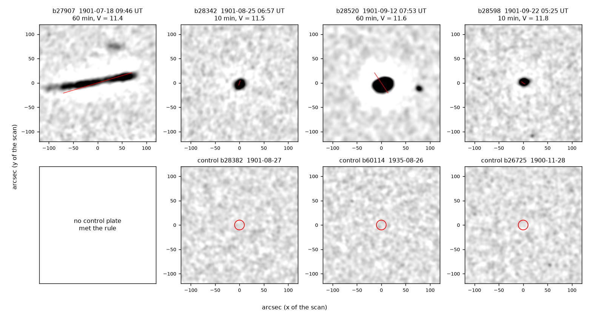

# Candidate images of the near-Earth asteroid (1627) Ivar on Harvard plates of 1901, 28 years before its discovery

(1627) Ivar is a near-Earth asteroid about 9 km across. E. Hertzsprung discovered it at Johannesburg on 1929 Sep 25. In the JPL and Minor Planet Center records, no observation of Ivar is earlier than that night. Harvard College Observatory keeps a large collection of photographic glass plates of the sky, and the DASCH project made scans of these plates public. An asteroid that was on the sky before its discovery can be on these plates. An image of this kind is called a *precovery*.

We wrote down the plate rule, the predicted positions and the test before we looked at any image, and put this protocol in git. Then we downloaded the scans. The rule gave four measurable plates of 1901, all from the Harvard station at Arequipa, Peru. All four pass the test. Plates of the same sky on other dates show nothing at these positions. On the earliest plate, 1901 Jul 18, the source is a trail with the length and the direction of the predicted motion of Ivar. One plate of 1929, 13 days before the discovery, does not show Ivar.

We report the four images as candidates. Nobody has examined the glass plates, and no position has been sent to the Minor Planet Center. If an expert confirms them, the observed history of Ivar starts 28 years earlier.



Public data; not yet reviewed by experts.

[Read the paper](paper/paper.pdf) · [LaTeX source](paper/paper.tex) · [Pre-registered protocol](PROTOCOL.md) · [Numbers and their sources](NUMBERS.md)

## Abstract

The earliest observation of the near-Earth asteroid (1627) Ivar in the JPL Small-Body Database and in the Minor Planet Center observation list is its discovery on 1929 Sep 25. We searched public scans of Harvard plates of the bright apparitions of 1901, 1906 and 1929 for it with a test that we registered in advance: the plate rule, the predicted positions, the statistic and the decision rule were committed before any image was downloaded. The rule selected six plates. One plate does not cover the position, and no 1906 plate met the rule. All four measurable plates of 1901, taken at Arequipa from 1901 Jul 18 to 1901 Sep 22, pass the per-plate threshold. The probability of four passes under the per-plate null rates, which come from 300 random regions on each plate, is about 1e-6 (1.2e-6; 1.8e-5 with the upper 95% limit of each rate), below the registered threshold of 1e-3. The one plate of 1929, 13 days before the discovery, fails. Plates of other dates show no source at the three positions where such plates exist. A measurement made after the decision puts the source within about 4" of the JPL Horizons position on three plates. On the fourth plate, the earliest, the source is a 162" trail along the predicted direction of motion. That plate alone is weak in the registered test, and it has no control plate. We report the four images as candidates. Nobody has examined the glass plates, and no position has been reported to the Minor Planet Center. If confirmed, the images extend the observed arc of Ivar by 28.2 years. This work has not yet been reviewed by experts. The computations, the code and the text were produced by AI models (from Anthropic and OpenAI), working under the author's direction.

## Check it

Run all commands in this section from this folder (`cd results/ivar-1901-harvard-plates` from the repository root). You need Python 3.13 and network access to `api.starglass.cfa.harvard.edu`, `ssd.jpl.nasa.gov` and `ssp.imcce.fr`.

```sh
bash checks/ci.sh
```

The script installs the pinned packages of `checks/requirements.txt` and runs `checks/rerun.py`. It downloads the 5 DASCH cutouts of the registered test (a sixth plate returns HTTP 422), the ATLAS reference stars, the 6 control-plate cutouts, the JPL Horizons positions and the SkyBoT lists again (about 10 MB). It reruns the registered test, the controls and the measurements after the decision, and compares 132 values with `data/expected.json`. It ends with `132 of 132 checks match`, the number of cutouts that are byte-identical to the ones used for the paper (`5 of 5`, `6 of 6`), and `ci: all checks passed`. Run time on a Steam Deck (one core): 5 min 3 s wall time (1 min 16 s CPU), most of it downloads with 3 s pauses between requests. [More detail](checks/README.md).

## Credits

Plate scans: DASCH (Digital Access to a Sky Century @ Harvard), Harvard College Observatory. Ephemerides: JPL Horizons and the JPL Small-Body Database. Reference stars: ATLAS-REFCAT2 (Tonry et al. 2018), served by DASCH. Known-object lists: IMCCE SkyBoT. The measurement code comes from the earlier result [ganymed-1898-harvard-plates](../ganymed-1898-harvard-plates). [Data sources and licences](THIRD_PARTY.md). Apache-2.0 (see the repository's LICENSE), except the third-party material listed in [THIRD_PARTY.md](THIRD_PARTY.md).

## Cite

```bibtex
@misc{WuIvar1901HarvardPlates2026,
  author       = {Wu, Qianghao},
  title        = {{Candidate images of the near-Earth asteroid (1627) Ivar on Harvard plates of 1901, 28 years before its discovery}},
  year         = {2026},
  howpublished = {\url{https://github.com/KenWuqianghao/kenwu-lab/tree/main/results/ivar-1901-harvard-plates}}
}
```
