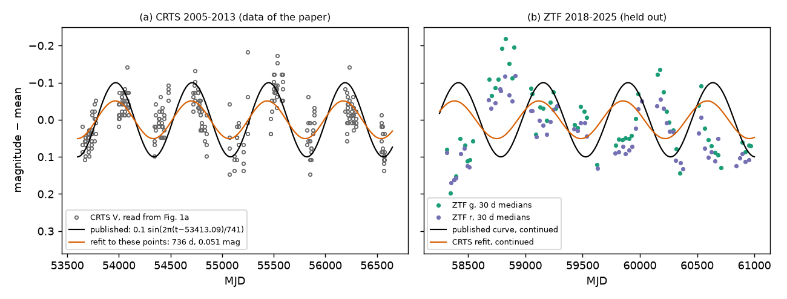

# The published 741-day light-curve formula of the quasar SDSS J0159+0105 fails on held-out ZTF data; post hoc, a weaker persistent 741-day signal is not excluded

Two supermassive black holes in a close orbit can make a quasar brighten and fade with the orbital period. So a quasar with a regular brightness cycle is a candidate binary. But all quasars also vary at random, and a few slow random swings can look like a cycle. A real cycle continues after the data that found it. A chance pattern usually does not.

[Zheng et al. (2016)](https://doi.org/10.3847/0004-637X/827/1/56) found two cycles, of about 741 and 1500 days, in the 2005-2013 Catalina (CRTS) light curve of the quasar SDSS J0159+0105. They gave the 741-day cycle as a formula: V = 0.1 sin(2π(t − 53413.09)/741) + 16.59, with t in days (MJD). We continued this formula to the public data of the Zwicky Transient Facility (ZTF) from 2018 to 2025. We wrote down the test before we downloaded the data.

**Result.**
- **Registered test.** The ZTF data do not follow the formula. They run in anti-phase with it: the fitted amplitude is T = -0.59, where the formula predicts T = 1. None of 5000 simulations of the formula plus random quasar variability gives so low a value (p < 0.0002). So the formula, at its published amplitude, period and phase, is refuted.
- **Part of this is not new.** The CRTS points in the paper's own figure give an amplitude of 0.05 mag, half of the published 0.1 mag. The new information from ZTF is the anti-phase.
- **Post hoc tests.** A period fitted to four cycles has an error. Over the gap to ZTF, this error can shift the phase by up to most of a cycle. When the simulations include this error, a real, persistent 741-day signal gives a ZTF result as low as the observed one in 0.6% to 9.8% of cases. So such a signal is not refuted. Random variability alone gives the observed result in 20% of cases, so ZTF gives no evidence for the signal either.
- **Not tested.** The 1500-day signal. The paper gives no formula for it.



Public data; not yet reviewed by experts.

[Read the paper](paper/paper.pdf) · [LaTeX source](paper/paper.tex) · [Pre-registered protocol and addendum](PROTOCOL.md) · [Source of each number](NUMBERS.md)

## Abstract

Zheng et al. (2016) reported two periodic signals, at about 741 and 1500 days, in the 8.1-year Catalina (CRTS) V-band light curve of the radio-quiet quasar SDSS J0159+0105 (z = 0.217), and proposed a supermassive black hole binary. They gave the 741-day signal as a formula: V = 0.1 sin(2π(t − 53413.09)/741) + 16.59. Their data end in 2013. Before we downloaded any later data, we registered a test of this formula on public Zwicky Transient Facility (ZTF) g and r data from June 2018 to October 2025 (2448 points, 2.3 to 5.9 cycles after the last CRTS point). The fitted amplitude of the continued formula is T = -0.59, where the formula predicts T = 1. In 5000 simulations of the formula plus damped-random-walk red noise, none gives T <= -0.59 (p < 2e-4; power 0.82). By the registered rule, the formula at its published amplitude, period and phase is refuted. A part of this failure is not new: the 252 CRTS points that we read from the paper's own figure give a 741-day amplitude of 0.050 mag, half of the published 0.1 mag. The new information from ZTF is the sign of T. Post hoc, we also tested a persistent sinusoid whose period, amplitude and phase are refitted to the CRTS points in each simulation. The period of this refit has a scatter of 15 to 72 d, so its phase at the ZTF epochs is uncertain by 0.1 to 0.8 cycle. Such a signal gives a ZTF result as low as the observed one in 0.6% to 9.8% of simulations over eight noise models. So a persistent signal near 741 days is not refuted. Red noise alone gives the observed result in 20% of simulations, so the ZTF data give no evidence for the signal either. The 1500-day signal is not tested.

This work has not yet been reviewed by experts. The computations and the text were produced by AI models (from Anthropic and OpenAI), working under the author's direction.

## Check it

Run all commands from this folder. You need Python 3.13 and an internet connection. The script downloads the ZTF light curve from IRSA (about 0.7 MB) and the arXiv source of Zheng et al. (about 1 MB).

```sh
python3 -m venv .venv && . .venv/bin/activate
bash checks/ci.sh
```

The script installs the pinned packages of `checks/requirements.txt`, downloads both files, reruns the pre-registered test and the post hoc tests, and compares every value with `data/expected.json`. It prints `OK` and `ci: all checks passed`. It also redraws `data/fig_forecast.png`. On a Steam Deck (AMD x86_64, 2 threads) the full run took 56 s, and the figure was byte-identical to the committed file.

[More detail](checks/README.md).

## Credits

Zhen-Ya Zheng, Nathaniel Butler, Yue Shen and their colleagues published the formula and a vector figure of their data, which made this test possible. Maria Charisi, Daniel D'Orazio and their colleagues recorded the candidate and its status in later work. The data come from the Zwicky Transient Facility through the NASA/IPAC Infrared Science Archive (IRSA). [Data sources and terms](THIRD_PARTY.md). Apache-2.0 (see the repository's LICENSE).

## Cite

```bibtex
@misc{WuJ0159PeriodicQuasarForecast2026,
  author       = {Wu, Qianghao},
  title        = {{The published 741-day light-curve formula of the quasar SDSS J0159+0105 fails on held-out ZTF data; post hoc, a weaker persistent 741-day signal is not excluded}},
  year         = {2026},
  howpublished = {\url{https://github.com/KenWuqianghao/kenwu-lab/tree/main/results/j0159-periodic-quasar-forecast}}
}
```
