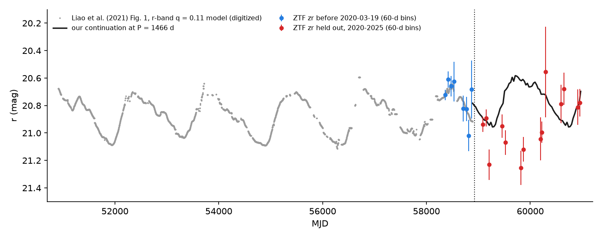

# A forward test of the circumbinary-accretion model of the periodic quasar SDSS J025214.67-002813.7 on ZTF data from 2020 to 2025

Two supermassive black holes in a close orbit can make a quasar brighten and fade with the orbital period. So a quasar with a regular brightness cycle is a candidate binary. But all quasars also vary at random, and a few slow random swings can look like a cycle. A real cycle continues after the data that found it. A chance pattern does not.

[Liao et al. (2021)](https://doi.org/10.1093/mnras/staa3055) found a 4.4-year cycle in the quasar SDSS J025214.67-002813.7 (J0252). Its light curve fits best to a bursty model from simulations of gas around a black-hole binary. Their r-band fit has a period of 1466 days. Their data end in early 2019. We continued their plotted model at that period and compared it with five more years of public data from the Zwicky Transient Facility (ZTF). We wrote down the test before we looked.

**Result.** The new data run against the forecast: the fitted amplitude of the continued model is T = -0.66, where the forecast predicts T = 1. But the quasar is near the faint limit of ZTF, and the data have more noise than a simple model gives. After a correction for both, the chance of so low a T if the forecast is true is 0.01 to 0.04. This is above our pre-registered threshold of 0.01. So the data disfavour the forecast but do not refute it. The test has low power (about 0.3). The test concerns only the 1466-day continuation. Continuations near 1600 days, the other period of Liao et al., agree with the data (post hoc).



Public data; not yet reviewed by experts.

[Read the paper](paper/paper.pdf) · [LaTeX source](paper/paper.tex) · [Pre-registered protocol and addendum](PROTOCOL.md) · [Source of each number](NUMBERS.md)

## Abstract

Liao et al. (2021) reported a 4.4-yr periodicity in the optical light curves of the quasar SDSS J025214.67-002813.7 (J0252) and found that a bursty circumbinary-accretion model (mass ratio q = 0.11) fits them best. Their r-band fit has a period of 1466 d, and their data end in early 2019. We continued their plotted r-band model in phase at 1466 d and compared it with the public ZTF r-band data from July 2020 to October 2025 (97 detections, about 1.3 cycles). We wrote down the test before we compared the data with the model. The fitted amplitude of the continued curve is T = -0.66, where the forecast predicts T = 1 and no relation gives T = 0. So the data run in anti-phase with the continuation. The quasar is near the ZTF detection limit, and the first noise model did not include this. A post hoc addendum, written before its computation, added detection censoring and the damped-random-walk parameters that Liao et al. published. In this model, if the forecast is true, the probability of T <= -0.66 is 0.0005 at their best-fit noise parameters and at most 0.002 in their 68% region. Nearby ZTF objects show 1.7 to 2.1 times more scatter in T than the model gives. After this calibration the probability is 0.01 to 0.04, which is above the registered threshold of 0.01. So the data disfavour the continuation but do not refute it. The test has low power (about 0.3). Post hoc, continuations at 1604 and 1607 d, inside the period ranges of Liao et al., give a positive T. The result does not test the 4.4-yr periodicity as such.

This work has not yet been reviewed by experts. The computations and the text were produced by AI models (from Anthropic and OpenAI), working under the author's direction.

## Check it

Run all commands from this folder. You need Python 3.13 and an internet connection (the script downloads about 10 MB from IRSA).

```sh
python3 -m venv .venv && . .venv/bin/activate
bash checks/ci.sh
```

The script installs the pinned packages of `checks/requirements.txt`, downloads the ZTF light curves, reruns the pre-registered test and its addendum, and compares every value with `data/expected.json`. It prints `OK` and `ci: all checks passed`. Run time: 3.5 to 4 min on one thread of a Steam Deck (AMD x86_64), including the download (208 s and 248 s in two runs). It also redraws both figures; on that machine they were byte-identical to the committed files.

The independent implementation of the verification stage takes about 25 s after the run above:

```sh
python3 -I checks/verify/v4_censored_independent.py work/placebo/cone.csv data/model_r_digitized.json
```

[More detail](checks/README.md), including how to redo the two digitizations from the arXiv source.

## Credits

Wei-Ting Liao, Yu-Ching Chen, Xin Liu and their colleagues published the model curve, its period and the posterior of their noise model in enough detail to make this test possible. They also asked for continued follow-up. Covino, Tobar and Treves pointed out that the periodicity could be a chance result. The data come from the Zwicky Transient Facility through the NASA/IPAC Infrared Science Archive (IRSA). [Data sources and terms](THIRD_PARTY.md). Apache-2.0 (see the repository's LICENSE).

## Cite

```bibtex
@misc{WuJ0252PeriodicQuasarForecast2026,
  author       = {Wu, Qianghao},
  title        = {{A forward test of the circumbinary-accretion model of the periodic quasar SDSS J025214.67-002813.7 on ZTF data from 2020 to 2025}},
  year         = {2026},
  howpublished = {\url{https://github.com/KenWuqianghao/kenwu-lab/tree/main/results/j0252-periodic-quasar-forecast}}
}
```
