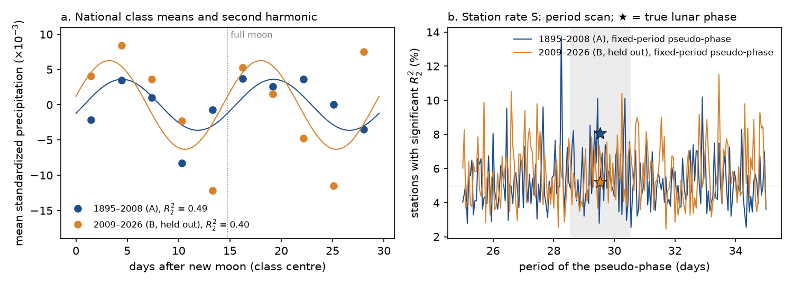

# The reported lunar-phase signal in US precipitation: a held-out test and a null that keeps spatial correlation

In 2010, Cerveny, Svoma and Vose reported that US daily precipitation follows the phase of the Moon. At 1218 weather stations in 1895–2008, rain was a little more frequent in the week after new moon and in the week after full moon. They also reported that 23.1% of the stations show this pattern at the 0.05 significance level.

We tested the claim in two ways. First, we used the years 2009–2026, which did not exist in 2010. Second, we used a null model that keeps the fact that nearby stations get the same storms. The test was written down and committed before we read any precipitation value.

The claim does not replicate in 2009–2026, but these 18 years can reliably detect only an effect of about 10%, and the effect in 1895–2008 is about 1% or less. In 1895–2008 we get the same national pattern as the paper, but it is not significant when the null keeps the correlation between stations. The 1895–2008 station rate is at the 0.05 boundary, and its p-value depends on the hour of day at which the lunar phase is computed.



*Left: national mean precipitation in 10 lunar-phase classes, 1895–2008 and 2009–2026, with the fitted second harmonic. Right: share of significant stations when the lunar phase is replaced by a cycle of fixed period; the stars are the true lunar phase.*

Public data; computer-assisted; not yet reviewed by experts.

[Read the paper](paper/paper.pdf) · [LaTeX source](paper/paper.tex)

## Abstract

Cerveny, Svoma and Vose (2010) reported that, at 1218 US Historical Climatology Network (HCN) stations in 1895–2008, the second harmonic of the lunar synodic month explains 0.4106 of the variance of national mean daily precipitation in 10 lunar-phase classes (p < 0.03), and that 23.1% of the stations have a significant second harmonic. We pre-registered a test of both statistics on held-out GHCN-Daily data for 2009–2026. The null model rotates the lunar phase by a random amount in each calendar year, at all stations together, so it keeps the correlation between stations. In the held-out years neither statistic is significant (national R²_2 = 0.40, p = 0.41; station rate 5.2%, p = 0.57). These 18 years detect a lunar modulation of precipitation of 10% with power 0.97 or more and one of 5% with power 0.36 to 0.52. They cannot detect one of about 1%. In 1895–2008 we reproduce the national statistic (R²_2 = 0.49, first maximum 4.5 days after new moon), but it is not significant under the same null (p = 0.12) or under an F test (p = 0.09). With the pre-registered station test, 8.05% of the stations are significant (null mean 5.5%, p = 0.10). A more liberal station test gives 23.4%, close to the published 23.1%, against a null mean of 17.8%. In exploratory analyses, the 1895–2008 station rate is at the 0.05 boundary: its p-value goes from 0.02 to 0.14 with the hour of the phase computation, which the source does not state. With a null that keeps the correlation between stations, the data do not support the reported significance of the signal, and they cannot exclude an effect of about 1%.

This work has not yet been reviewed by experts. The computations, the proofs and the text were produced by AI models (from Anthropic and OpenAI), working under the author's direction.

## Check it

With Python 3.13 and an internet connection, from this folder:

```sh
bash checks/ci.sh
```

The script installs the pinned packages of `checks/requirements.txt`, downloads about 350 MB of public data (GHCN-Daily HCN archive and the JPL ephemeris DE440s), recomputes the study, and compares 252 numbers with `data/expected.json`. It prints `252/252 match` and exits 0. On an M1 Pro laptop with 2 threads the run took about 24 minutes (1449 s wall time, including about 350 MB of downloads; 2026-11-25). It needs about 3 GB of memory. See [checks/README.md](checks/README.md) for the parts of the computation.

NCEI updates the archive every day and does not keep old versions. A later download can change some values a little. The comparison uses tolerances, and it prints each difference.

## Credits

Randall S. Cerveny, Bohumil M. Svoma and Russell S. Vose published the claim and described their method. NOAA NCEI publishes GHCN-Daily (Menne et al. 2012). NASA JPL publishes the DE440s ephemeris (Park et al. 2021). Brandon Rhodes maintains Skyfield. Glenn W. Brier, Donald A. Bradley, Iver A. Lund and Kirby Hanson and colleagues did the earlier work on lunar phase and US precipitation. Data sources and licenses are in [THIRD_PARTY.md](THIRD_PARTY.md).

## Cite

```bibtex
@misc{WuLunarPhaseUSPrecipitation2026,
  author = {Wu, Qianghao},
  title  = {{The reported lunar-phase signal in US precipitation: a held-out test and a null that keeps spatial correlation}},
  year   = {2026},
  howpublished = {\url{https://github.com/KenWuqianghao/kenwu-lab/tree/main/results/lunar-phase-us-precipitation}}
}
```

Archived on Zenodo: [doi:10.5281/zenodo.24580728](https://doi.org/10.5281/zenodo.24580728)
