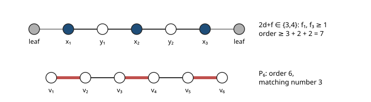

# No spectrally minimal graph of order 2k with matching number k lies in Hou and Tan's family T'_{2k,k}

A [matching](https://en.wikipedia.org/wiki/Matching_(graph_theory)) in a graph is a set of edges with no shared vertex. The matching number is the size of the largest matching. The [spectral radius](https://en.wikipedia.org/wiki/Spectral_radius) ρ(G) of a graph is the largest eigenvalue of its adjacency matrix. Let G_{n,k} be the family of connected graphs with n vertices and matching number k. Which graphs in G_{n,k} have the smallest spectral radius? These graphs are called *spectrally minimal*. Liu, Lou and Trevisan ([arXiv:2601.18223](https://arxiv.org/abs/2601.18223)) asked this question, showed that the answers are trees, and solved it for k = 2, 3 and 4. Hou and Tan ([arXiv:2607.11061](https://arxiv.org/abs/2607.11061)) proved a sharp lower bound for ρ on G_{n,k}. For general n ≥ 2k they also defined a family T'_{n,k} of trees (their Construction 9): take a tree T1 on k vertices, put a new vertex on each edge, and add f_i leaves at the i-th vertex, where 2·deg(i) + f_i must be c or c + 1 with c = ⌊(n + 2k − 3)/k⌋. They asked:

> for arbitrary n and k, must every spectrally minimal graph in G_{n,k} belongs to T'_{n,k}.

**Result.** The answer to the question, as written in arXiv v2, is no. For every k ≥ 3 and n = 2k, Construction 9 gives no tree with 2k vertices: each tree that it builds has at least 2k + 1 vertices. But G_{2k,k} is not empty: it contains the path P_{2k}. So the spectrally minimal graphs of G_{2k,k} are not in T'_{2k,k}.



The proof is a degree count. For n = 2k and k ≥ 3, c = 3. Each vertex of T1 then has deg + f_i ≥ 2. The degrees of a tree on k vertices add up to 2k − 2, so the leaves add up to at least 2. The built tree has k + (k − 1) + Σ f_i ≥ 2k + 1 vertices.

The result is at the boundary n = 2k of the range of Construction 9. It does not touch n ≥ 2k + 1, which is the main part of the question. There, a search over all trees with at most 20 vertices finds every spectrally minimal graph in T'_{n,k}, so the question for n ≥ 2k + 1 stays open. We did not read the journal version of Hou and Tan's paper ([Linear Algebra Appl. 755 (2027)](https://doi.org/10.1016/j.laa.2026.10.032)). It is not confirmed that it keeps the range n ≥ 2k.

Computer-assisted; not yet reviewed by experts. Lean checks the degree count for all k ≥ 3. The facts about the path are proved by hand in the paper and checked by computer for small k.

[Read the paper](paper/paper.pdf) · [LaTeX source](paper/paper.tex)

## Abstract

Let G_{n,k} be the family of connected graphs of order n with matching number k. Hou and Tan (arXiv:2607.11061v2) proved a sharp lower bound for the spectral radius on G_{n,k}. For general n ≥ 2k they defined a family T'_{n,k} of trees (Construction 9) and asked: for arbitrary n and k, must every spectrally minimal graph in G_{n,k} belong to T'_{n,k}? We show that the answer to this question, as written in arXiv v2, is no. The failure is at the boundary n = 2k of the range of the construction. For every k ≥ 3, Construction 9 with n = 2k gives no tree of order 2k: each tree that it builds has at least 2k+1 vertices. The path P_{2k} is in G_{2k,k}, so G_{2k,k} has spectrally minimal graphs, and none of them is in T'_{2k,k}. The proof is a short degree count. Lean 4 with Mathlib checks the counting step for all k ≥ 3, with only the standard axioms; the facts about P_{2k} are elementary and are checked by hand and by computer for small k. The result does not touch the range n ≥ 2k+1. There, a floating-point search over all trees of order at most 20 finds every spectrally minimal graph in T'_{n,k} (90 pairs (n,k)), so the question restricted to n ≥ 2k+1 stays open. We did not read the journal version of the source paper (Linear Algebra Appl. 755 (2027)), so we do not know if its text has the same range. This work has not yet been reviewed by experts. The computations, the proofs and the text were produced by AI models (from Anthropic and OpenAI), working under the author's direction.

## Check it

From this folder, with Python 3.10 or later:

```sh
python3 -I checks/verify.py 8        # < 1 s, standard library only: no tree of order 2k for k = 3..8
bash checks/ci.sh                    # about 3 min: installs NetworkX and NumPy, runs all checks
```

`ci.sh` runs the exact checker, an independent checker that builds the trees explicitly, the search over all trees with at most 20 vertices, and a check of the numbers in the paper. The Lean proof, with [elan](https://github.com/leanprover/elan) and a Lean project on Mathlib tag v4.36.0 (Lean v4.36.0):

```sh
lake env lean lean/Solution.lean
```

Run it from the root of the Lean project, with the path to this file. It takes about 15 seconds after Mathlib is built (12 s measured). It prints `'construction9_no_tree_of_order_two_mul' depends on axioms: [propext, Classical.choice, Quot.sound]`. Times are for one core of a Steam Deck. The [checking guide](checks/README.md) explains each check.

## Credits

Xinmin Hou and Li Tan defined T'_{n,k} and asked the question ([arXiv:2607.11061](https://arxiv.org/abs/2607.11061); Linear Algebra Appl. 755 (2027) 151–163, [doi:10.1016/j.laa.2026.10.032](https://doi.org/10.1016/j.laa.2026.10.032)). Jiaqi Liu, Zhenzhen Lou and Vilmar Trevisan posed the problem of the spectrally minimal graphs in G_{n,k} and showed that they are trees ([arXiv:2601.18223](https://arxiv.org/abs/2601.18223); Linear Algebra Appl. 746 (2026) 88–110, [doi:10.1016/j.laa.2026.05.011](https://doi.org/10.1016/j.laa.2026.05.011)). The Lean proof uses [Lean](https://github.com/leanprover/lean4) and [Mathlib](https://github.com/leanprover-community/mathlib4). The checks use [NetworkX](https://networkx.org) and [NumPy](https://numpy.org). Apache-2.0 (see the repository's LICENSE); [THIRD_PARTY.md](THIRD_PARTY.md) lists the third-party material.

## Cite

```bibtex
@misc{WuMatchingNumberMinimalSpectral2026,
  author       = {Wu, Qianghao},
  title        = {{No spectrally minimal graph of order 2k with matching number k lies in Hou and Tan's family T'_{2k,k}}},
  year         = {2026},
  howpublished = {\url{https://github.com/KenWuqianghao/kenwu-lab/tree/main/results/matching-number-minimal-spectral}}
}
```
