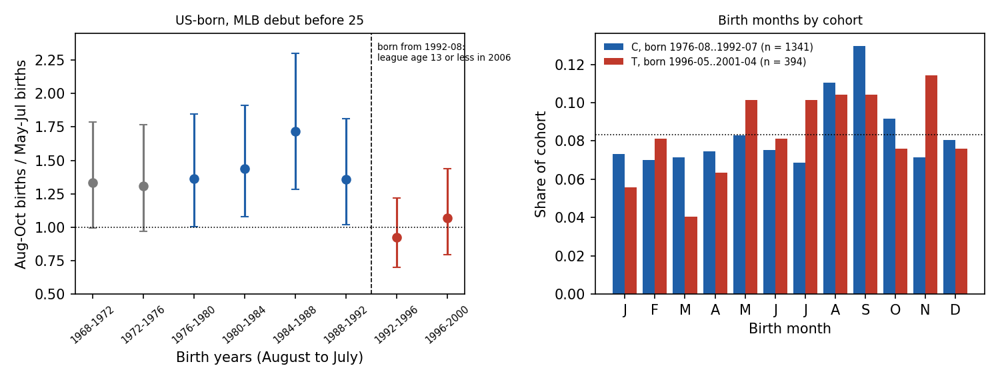

# The August excess of US-born major leaguers is not seen in the cohorts born after the 2006 youth-baseball cutoff change

Many US-born major leaguers were born in August, and few in July. In 2008, G. Spira counted in Slate 503 August births against 313 July births. The usual explanation is the age cutoff of US youth baseball. For more than 55 years, Little League grouped children by their age on July 31. So a child born in August was the oldest of the group, and a child born in July was the youngest.

From the 2006 season, Little League moved the cutoff to April 30. Spira predicted that May would then become the lucky month. The first children who played all of their Little League years under the new rule were born from May 1996. Most of them are now old enough to have reached the major leagues.

We wrote down the test before we counted the new cohort. Among US-born players who debuted before age 25, the ratio of August–October to May–July births is 1.46 for those born 1976–1992 and 1.00 for those born 1996–2001. The change passes the pre-registered test (odds ratio 1.46, one-sided p = 0.0079), and a placebo split gives p = 0.74. No May peak appears. The fall starts about three birth years earlier than the protocol expected, and it is not significant when the debut limit is 24 instead of 25. The result is an association. It does not prove that the cutoff caused the change.



*Left: ratio of Aug–Oct to May–Jul births by four-year birth bin, US-born players with a debut before age 25, with 95% intervals. Right: share of each birth month in the cohort born 1976–1992 (blue) and the cohort born 1996–2001 (red).*

Public data; computer-assisted; not yet reviewed by experts.

[Read the paper](paper/paper.pdf) · [LaTeX source](paper/paper.tex) · [Pre-registered protocol](PROTOCOL.md)

## Abstract

G. Spira (Slate, 2008) counted 503 August and 313 July births among US-born major leaguers and attributed the excess to the July 31 age cutoff of US youth baseball. Little League moved the cutoff to April 30 from the 2006 season. We pre-registered a test of whether the ratio of August–October to May–July births changed between US-born players born from August 1976 to July 1992 (July 31 rule at league ages 9 to 12) and those born from May 1996 to April 2001 (April 30 rule at those ages). The data are the MLB Stats API player lists for the seasons 1985–2026. A player counts only if he debuted before age 25, so that every birth month has the same time to reach the major leagues. The ratio is 445/304 = 1.46 in the earlier cohort and 112/112 = 1.00 (95% interval 0.77 to 1.30) in the later cohort. The odds ratio is 1.46 (95% CI 1.08 to 1.98), one-sided Fisher p = 0.0079. A placebo split of the earlier cohort gives p = 0.74. By the pre-registered rule, the result supports a change. Spira's predicted May peak is not seen. Exploratory analyses limit the result. The fall starts about three birth years before the later cohort, with players who played most or all of league ages 9 to 12 under the old rule, so the data cannot place the effect at those ages. With a debut limit of 24 instead of 25, the change is not significant (p = 0.29). Players born outside the USA show no excess and no change, and US birth seasonality predicts an odds ratio of 1.002. The result is an association across birth cohorts.

This work has not yet been reviewed by experts. The computations, the code and the text were produced by AI models (from Anthropic and OpenAI), working under the author's direction.

## Check it

With Python 3.10 or later and an internet connection, from this folder:

```sh
bash checks/ci.sh
```

The script downloads 42 MLB Stats API season lists (1985–2026) and the CDC monthly birth counts, recomputes every number of the paper with the Python standard library, and compares all of them with `data/expected.json`. It prints the numbers as JSON, then `MATCH expected.json`, and exits 0. On a Steam Deck (1 thread) the run took 73 s, including the downloads (2026-11-28). See [checks/README.md](checks/README.md) for the details and for the independent recounts.

The MLB Stats API can correct its records. A later download can change a count, and the script then prints `MISMATCH expected.json`.

## Credits

G. Spira published the count and the prediction. Angus H. Thompson, Roger H. Barnsley and George Stebelsky, Ernest L. Abel and Michael L. Kruger, B. Zhang and colleagues, Chad H. Herring, Kyle S. Beyer and David H. Fukuda, and Jarosław Duda did the earlier work on birth months in baseball. Ben Jedlovec wrote about the 2006 change on Bill James Online. MLB Advanced Media publishes the Stats API. Jake VanderPlas compiled the CDC/NCHS birth counts. Retrosheet supplied the biographical file for the second-source recount. Data sources and terms are in [THIRD_PARTY.md](THIRD_PARTY.md).

## Cite

```bibtex
@misc{WuMlbBirthMonthCutoffChange2026,
  author = {Wu, Qianghao},
  title  = {{The August excess of US-born major leaguers is not seen in the cohorts born after the 2006 youth-baseball cutoff change: a pre-registered test}},
  year   = {2026},
  howpublished = {\url{https://github.com/KenWuqianghao/kenwu-lab/tree/main/results/mlb-birth-month-cutoff-change}}
}
```
