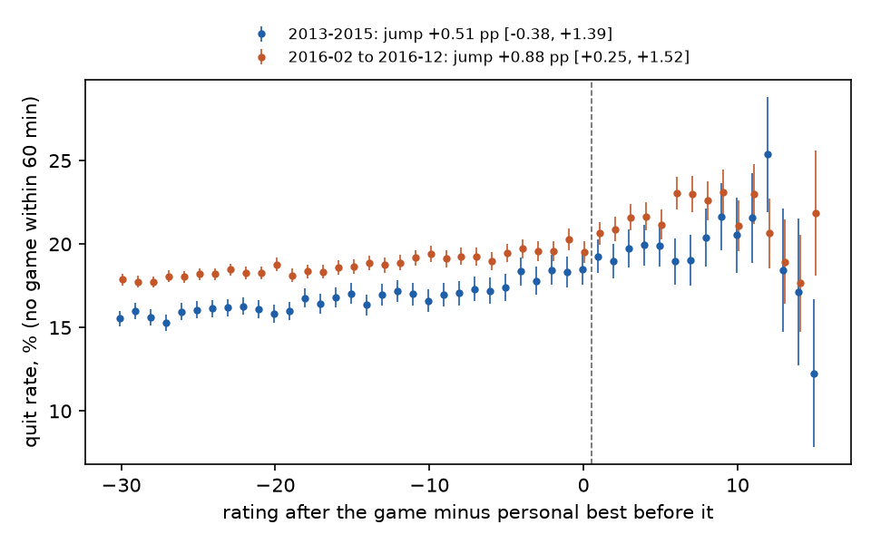

# Do players quit after a new personal-best rating? A pre-registered, placebo-controlled test on Lichess

In 2018, Ashton Anderson and Etan Green showed that chess players on the Free Internet Chess Server (FICS) quit more often just after they reach a new personal-best rating. The chance that a player stops for at least an hour jumps by 4.5 percentage points (pp) at the personal best. We asked if the same jump occurs on Lichess, a second large chess site that publishes all its games.

We rebuilt the rating history of every Lichess blitz player from 45 million games of 2013-2015. We fixed the full test and its controls before we computed any quit rate. The jump at a new personal best is +0.51 pp, with a 95% confidence interval from -0.38 to +1.39 pp. The FICS value of 4.5 pp is outside this interval. The same method finds a clear jump at round-number ratings (+2.83 pp), so it can detect a reference point in these data. In 2016, after the Lichess code added a "Highest rating" display, a small jump of +0.88 pp appears. It is not robust to all variants, and it is not significantly larger than before.



Public data; not yet reviewed by experts.

[Read the paper](paper/paper.pdf) · [LaTeX source](paper/paper.tex) · [Pre-registered protocol](PROTOCOL.md)

## Abstract

Anderson and Green (PNAS, 2018) found that blitz players on the Free Internet Chess Server (FICS) quit more often just after they set a new personal-best rating: the probability of quitting jumps by 4.5 percentage points (pp), or 20%. We test the same claim on Lichess with public data. We rebuilt the rating history of every Lichess blitz player from the headers of all 45 million rated games of 2013-2015. Before we computed any quit rate, we fixed the sample, the estimator (local linear regression, triangular kernel, bandwidth 15 rating points, errors clustered by player), the controls and a decision rule. Among 10.8 million player-games after a win, with 37,391 new personal bests, the jump in the probability of quitting (no new game within 60 minutes) is +0.51 pp, 95% confidence interval -0.38 to +1.39 pp, on a quit rate of 18.55% just below the personal best. The interval contains zero, and its upper bound is below 4.5 pp. With the same estimator, a known reference point (ratings that cross a multiple of 100) gives +2.83 pp (z = 28.6), and an added step of 4.5 pp is recovered. Placebo cutoffs and a within-player shuffle show no jump. In a second test, fixed before its data were downloaded, we used 2016, after the Lichess source code added a "Highest rating" display to its statistics pages. The jump is +0.88 pp (+0.25 to +1.52). This jump is small and not robust to all variants, and it is not significantly larger than in 2013-2015. The upper bounds of the two primary intervals, 1.39 and 1.52 pp, are about one third of the FICS value. The result is an association on one platform. It does not show that the FICS result is wrong.

This work has not yet been reviewed by experts. The computations and the text were produced by AI models (from Anthropic and OpenAI), working under the author's direction.

## Check it

The quick check needs Python 3.10 or later and no packages. It runs in under a second. It checks each of the 77 numbers that the paper takes from the results against `data/*.json` and the logs of the independent check.

```sh
python3 checks/paper_numbers.py
```

The full check reruns the primary analysis from the raw Lichess files. It needs Python 3.13, `curl`, `zstd` and `shasum`, about 8 GB of free disk and less than 4 GB of RAM. It streams about 8.3 GB from database.lichess.org and stores only the headers. It took 13 minutes on an M1 Pro laptop with a fast connection ([data/ci_log.txt](data/ci_log.txt)); the download time depends on the connection.

```sh
bash checks/ci.sh                 # quick check, then rerun of 2013-2015
PBQ_FULL=1 bash checks/ci.sh      # also rerun the 2016 addendum (about 22 GB in total; 44 and 53 min in two earlier runs)
```

The script installs the pinned packages of `checks/requirements.txt` in a temporary venv. It compares every number with `data/expected.json` at a relative tolerance of 1e-9, and it exits non-zero on a difference.

## Credits

Ashton Anderson and Etan A. Green stated the claim and its definitions. Lichess and its contributors publish the game database under CC0. The Lichess source code (lichess-org/lila) gave the date of the "Highest rating" display. Data sources and licenses: [THIRD_PARTY.md](THIRD_PARTY.md).

## Cite

```bibtex
@misc{WuPersonalBestQuittingLichess2026,
  author = {Wu, Qianghao},
  title = {{Do players quit after a new personal-best rating? A pre-registered, placebo-controlled test on Lichess}},
  year = {2026},
  howpublished = {\url{https://github.com/KenWuqianghao/kenwu-lab/tree/main/results/personal-best-quitting-lichess}}
}
```

Archived on Zenodo: [doi:10.5281/zenodo.24580717](https://doi.org/10.5281/zenodo.24580717)
