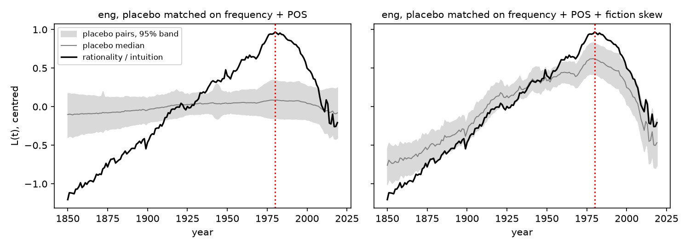

# Random words with the same fiction skew show the 1980 "rationality reversal" in Google Books

In 2021, Scheffer and colleagues reported that English books use words about science and rationality (such as *data*, *method*, *percent*) more and more from 1850 to about 1980, and words about belief and the senses (such as *soul*, *believe*, *feel*) less. After 1980 the trend reverses. We ask a simple question: do random words show the same turn?

Random words with the same frequency and part of speech do not: against them, the turn is extreme. But the science words are rare in novels and the belief and sense words are common in novels. Random words with the same "fiction skew" show the same rise and fall. In a pre-registered test, 12.6% of 10,000 such random pairs turn as sharply at 1980 as the original words (p = 0.126). So the test does not show that the turn is specific to these words beyond the register in which they are used. The test is a non-rejection: it would find an extra specific turn of 25% of the observed size with probability 0.77.



*Black: the log ratio of the rationality words to the intuition words in Google Books English. Grey: 95% band of 10,000 random pairs. Left: matched in frequency and part of speech. Right: also matched in fiction skew (the pre-registered primary control).*

Public data; computer-assisted; not yet reviewed by experts.

[Read the paper](paper/paper.pdf) · [LaTeX source](paper/paper.tex)

## Abstract

Scheffer, van de Leemput, Weinans and Bollen (PNAS, 2021) reported that in Google Books the frequency of words about rationality and science, relative to words about belief and the senses, rose from 1850 and reversed in the 1980s. We ask if this turn is specific to these word sets. We pre-registered one statistic, the change of slope at 1980 of the log ratio of the two sets, and compared it with 10,000 pairs of random word sets. In the English 1-grams of Google Books Ngram version 3, our ratio agrees with the authors' ratio (correlation 0.99997). The observed change of slope is -0.449 per decade. Against random words matched only in frequency and part of speech, it is extreme (p = 0.0001). The rationality words are rare in fiction and the intuition words are common in fiction. In the pre-registered primary test, the random words were also matched on this fiction skew. Then 12.6% of the pairs have a turn as negative or more negative (p = 0.126, threshold 0.05), and all 10,000 pairs rise before 1980 and fall after it. Thus the test does not show that the turn is specific to these word sets beyond their register. This is a non-rejection: an extra specific turn of 25% of the observed size would be detected with probability 0.77. The matched turn also occurs inside fiction alone and inside non-fiction alone, so the rising share of fiction in the corpus does not explain it alone. Post hoc, the rise before 1980 is more specific to the flag words than the turn.

This work has not yet been reviewed by experts. The analysis, the code and the text were produced by AI models (from Anthropic and OpenAI), working under the author's direction.

## Check it

The check streams the Google Books Ngram v3 English and English-fiction 1-grams (about 7.3 GB; only an extract of about 0.5 GB is kept), rebuilds the word table, clones the authors' repository for the known-answer check, reruns the pre-registered analysis and the post-hoc numbers, and compares 419 numbers with `data/expected.json` and `data/expected_posthoc.json`. It needs Python 3.13, `cc`, `curl`, `gzip`, `git` and a network connection.

```sh
python3.13 -m venv .venv && .venv/bin/pip install -r checks/requirements.txt
.venv/bin/python -I checks/rerun.py --workdir work
```

Run time: about 10 minutes on an M1 Pro laptop with a fast network, most of it download. The last lines are `compared 419 values; mismatches: 0` and the primary result. With the extracts already in `work/ext`, add `--reuse` (about 1.5 minutes). `bash checks/ci.sh` does the same in a temporary directory. Details: [checks/README.md](checks/README.md).

## Credits

Marten Scheffer, Ingrid van de Leemput, Els Weinans and Johan Bollen published the claim, their word lists, their count tables and their notebooks. Google publishes the Ngram data under CC BY 3.0. Simon DeDeo and Kun Sun discussed the result in published letters, and Victor Mair in a Language Log post. Sources and licenses: [THIRD_PARTY.md](THIRD_PARTY.md).

## Cite

```bibtex
@misc{WuRationalityNgramPlacebo2026,
  author = {Wu, Qianghao},
  title  = {{Random words with the same fiction skew show the 1980 ``rationality reversal'' in Google Books}},
  year   = {2026},
  note   = {Public data; computer-assisted; not yet reviewed by experts}
}
```

Archived on Zenodo: [doi:10.5281/zenodo.24580831](https://doi.org/10.5281/zenodo.24580831)
