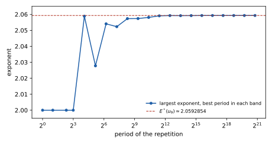

# A rich word over five letters with critical exponent E*(u₉), and the bound RT(C₅) ≤ E*(u₉) ≈ 2.0592854

A word is [rich](https://en.wikipedia.org/wiki/Palindrome#Palindromic_richness) if it has as many distinct palindromes as it can: a word of length n has at most n + 1 distinct palindromic factors (blocks of consecutive letters), counting the empty word, and a rich word has exactly n + 1. An infinite word is rich if all of its finite factors are rich. A repetition is a factor such as `0102010` that repeats a block with a fraction of the block at the end; its exponent is its length divided by the length of the block (here 7/4). The critical exponent E of an infinite word is the supremum of the exponents of its repetitions. The repetition threshold RT(C_d) asks how small this supremum can be for an infinite rich word over d letters.

Let u_d be the fixed point of the morphism φ_d: i ↦ 0(i+1) for i < d − 1 and d − 1 ↦ 0(d−1)(d−1). Ľubomíra Dvořáková and Edita Pelantová conjectured that RT(C_d) = E*(u_{2d−1}), where E* is the asymptotic critical exponent. The value is known for d = 2, 3 and, since November 2026, for d = 4. In [An automated approach to structure theorems for minimally repetitive rich words](https://arxiv.org/abs/2611.13676) (Section 8, item 1), Dvořáková, Lucas Mol and Pelantová name the first step for d ≥ 5: find a morphism π from 2d − 1 letters to d letters such that π(u_{2d−1}) is rich and E(π(u_{2d−1})) = E*(u_{2d−1}).

We do this step for d = 5. The morphism

| i | 0 | 1 | 2 | 3 | 4 | 5 | 6 | 7 | 8 |
|---|---|---|---|---|---|---|---|---|---|
| π(i) | `01` | `011` | `0` | `02` | `0232` | `023432` | `02343223432` | `0234344343343443432` | `023434434334344343234344343343443432` |

makes z = π(u₉) a rich word over five letters with E(z) = E*(u₉) = 1 + 1/(3 − Λ) ≈ 2.0592854490, where Λ is the root of t⁵ − 2t⁴ − 1 in (2, 3). So RT(C₅) ≤ E*(u₉). The lower bound RT(C₅) ≥ E*(u₉) remains open.

The proof uses a theorem of Dolce, Dvořáková and Pelantová: the critical exponent of such a word is 1 plus the supremum of |v|/|r| over bispecial factors v and their return words r. All bispecial factors of z come from 7 exceptional bispecial factors of u₉ and 16 infinite chains. A program compares each ratio with 1/(3 − Λ) in exact arithmetic and bounds the tail of each chain with a closed form. The figure shows a separate check from the definitions only: the largest exponent in the first 9.7 million letters of z rises towards E*(u₉) from below.



Computer-assisted; not yet reviewed by experts.

The computations, the proofs and the text were produced by AI models (from Anthropic and OpenAI), working under the author's direction.

[Read the paper](paper/paper.pdf) · [LaTeX source](paper/paper.tex)

## Abstract

A finite word of length n is rich if it has n + 1 distinct palindromic factors, counting the empty word. The repetition threshold RT(C_d) is the infimum of the critical exponents of the infinite rich words over d letters. Let u_d be the fixed point of φ_d: i ↦ 0(i+1) for i < d − 1, d − 1 ↦ 0(d−1)(d−1). Dvořáková and Pelantová conjectured that RT(C_d) = E\*(u_{2d−1}), where E\* is the asymptotic critical exponent. The conjecture is known for d = 2, 3, 4. Dvořáková, Mol and Pelantová (2026) named a first step for d ≥ 5: find a morphism π: Σ\*_{2d−1} → Σ\*_d such that π(u_{2d−1}) is rich and has critical exponent E\*(u_{2d−1}). We give such a morphism for d = 5. The letter images have lengths 2, 3, 1, 2, 4, 6, 11, 19, 36. So RT(C_5) ≤ E\*(u_9) = 1 + 1/(3 − Λ) ≈ 2.0592854490, where Λ is the root of t^5 − 2t^4 − 1 in (2, 3). The proof reduces the critical exponent to bispecial factors and their return words, by a theorem of Dolce, Dvořáková and Pelantová. We describe all bispecial factors of π(u_9) from seven exceptional bispecial factors of u_9 and sixteen infinite chains. A program compares each ratio with 1/(3 − Λ) in exact arithmetic, and bounds the tail of each chain with a closed form. Two programs written separately confirm the result, and a brute-force search on long prefixes agrees with it. The lower bound RT(C_5) ≥ E\*(u_9) remains open. This work has not yet been reviewed by experts. The computations, the proofs and the text were produced by AI models (from Anthropic and OpenAI), working under the author's direction.

## Check it

From this folder, with Python 3.13 and a C compiler:

```sh
python3 -m pip install -r checks/requirements.txt   # sympy, mpmath, numpy (pinned)
python3 checks/verify.py A           # about 30 s; last line: RESULT: ALL CHECKS PASSED
python3 checks/crosscheck.py A       # about 15 s, after verify.py A; RESULT: CROSS-CHECK PASSED
python3 checks/independent_check.py A   # about 25 s; RESULT: ALL OWN CHECKS PASSED
cc -O2 -o prefix_check checks/prefix_check.c
./prefix_check 01 011 0 02 0232 023432 02343223432 0234344343343443432 023434434334344343234344343343443432 3000000   # about 2 s
```

`bash checks/ci.sh` runs all of these, also for the candidates B and C, and compares every output with `checks/expected/`. Times are CPU times on an Apple M1 Pro. [The checks](checks/README.md) explain what each program does.

## What the proof assumes

- Theorem 3 of Dolce, Dvořáková and Pelantová (critical exponent from bispecial factors and return words).
- Theorem 4 of Dvořáková and Pelantová, *The limit of repetition thresholds of rich sequences* (richness from bilateral orders).
- From Dvořáková, Klouda and Pelantová: the language of u_d is closed under reversal, and E*(u_d) = 1 + 1/(3 − Λ_d).
- The tail bound of each infinite chain uses 60-digit floating point, not interval arithmetic. The margins are large (paper, Section 6).

## Credits

Ľubomíra Dvořáková, Lucas Mol and Edita Pelantová's [An automated approach to structure theorems for minimally repetitive rich words](https://arxiv.org/abs/2611.13676) states the question, the definitions and the method that we follow for d = 4. Dvořáková and Pelantová's [The limit of repetition thresholds of rich sequences](https://doi.org/10.37236/14600) states the conjecture, the richness criterion, the class P_ret and the length condition that guided the search. Dvořáková, Karel Klouda and Pelantová's [The asymptotic repetition threshold of sequences rich in palindromes](https://doi.org/10.1016/j.ejc.2025.104124) gives E*(u_d). Francesco Dolce, Dvořáková and Pelantová's [On balanced sequences and their critical exponent](https://doi.org/10.1016/j.tcs.2022.10.014) gives the formula for the critical exponent. James D. Currie, Mol, Narad Rampersad and Jarkko Peltomäki found RT(C₂) and RT(C₃) ([binary](https://doi.org/10.23638/DMTCS-22-1-6), [ternary](https://doi.org/10.37236/13499)).

The programs use [Python](https://www.python.org/), [SymPy](https://www.sympy.org/), [mpmath](https://mpmath.org/) and [NumPy](https://numpy.org/); the paper uses LaTeX and [Matplotlib](https://matplotlib.org/) for the figure. See [THIRD_PARTY.md](THIRD_PARTY.md).

## Cite

```bibtex
@misc{WuRichWordsFiveLetters2026,
  author = {Wu, Qianghao},
  title  = {{A rich word over five letters with critical exponent $E^*(u_9)$, and the bound $\mathrm{RT}(C_5)\le E^*(u_9)\approx 2.0592854$}},
  year   = {2026},
  howpublished = {\url{https://github.com/KenWuqianghao/kenwu-lab/tree/main/results/rich-words-five-letters}}
}
```
