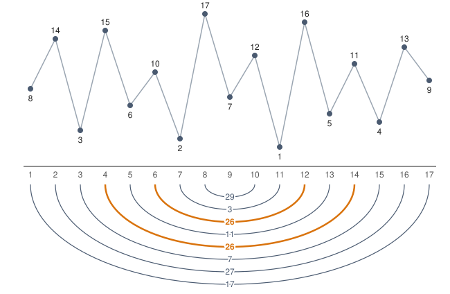

# The Odd Sum conjecture for Roller Coaster permutations fails at n = 17

Write a permutation of 1, 2, …, n as a sequence, for example 2 1 4 3. Take every subsequence with at least three entries, and count how many times it changes between going up and going down. More exactly, count its maximal increasing runs and maximal decreasing runs. The sum of these counts over all subsequences is t(π). A *Roller Coaster permutation* is a permutation with the largest t. These permutations go up and down as often as possible, in the whole sequence and in its parts.

Tanbir Ahmed and Hunter Snevily ([2013](https://tanbir.github.io/files/preprints/ahmed_snevily_roller_coaster_permutations.pdf)) computed all Roller Coaster permutations for n ≤ 13 and stated several conjectures. The [Open Problem Garden](http://www.openproblemgarden.org/op/roller_coaster_permutations) lists them. One is the *Odd Sum conjecture* (their Conjecture 2.4): for odd n = 2k + 1, in every Roller Coaster permutation the entries at mirror positions j and n + 1 − j have an odd sum, for j = 1, …, k.

**Result.** The conjecture is false for n = 17. The permutation

```
8 14 3 15 6 10 2 17 7 12 1 16 5 11 4 13 9
```

has t = 798783, and its mirror sums at j = 4 and j = 6 are both 26. Botler and Netto found this permutation with an integer linear program. An exact search shows that every permutation of 1, …, 17 with odd mirror sums has t ≤ 798775. So no permutation with the Odd Sum property is a Roller Coaster permutation. A second exact search finds all 128 Roller Coaster permutations of length 17. Each one has even mirror sums at exactly j = 4 and j = 6. For every n ≤ 16 the conjecture holds, so n = 17 is the smallest counterexample.



Computer-assisted; not yet reviewed by experts. Lean checks the value t = 798783 from the definition and the step from the search result to the failure of the conjecture. The search result itself is checked by two separately written programs, not by Lean.

[Read the paper](paper/paper.pdf) · [LaTeX source](paper/paper.tex)

## Abstract

For a permutation π of {1,…,n}, let t(π) be the total number of maximal increasing and maximal decreasing runs, summed over all subsequences of π with at least three entries. A Roller Coaster permutation is a permutation with the largest value of t. Ahmed and Snevily (2013) conjectured that every Roller Coaster permutation of odd length n = 2k+1 has the Odd Sum property: π_j + π_{n−j+1} is odd for 1 ≤ j ≤ k. We show that this conjecture is false for n = 17. The permutation 8, 14, 3, 15, 6, 10, 2, 17, 7, 12, 1, 16, 5, 11, 4, 13, 9, found by Botler and Netto with integer linear programming, has t = 798783, and two of its eight mirror sums are even. An exact exhaustive search shows that every permutation of {1,…,17} with the Odd Sum property has t ≤ 798775. A second exact search gives tmax(17) = 798783 and shows that the Roller Coaster permutations of length 17 are 128 permutations, none with the Odd Sum property. Netto's 2022 thesis already reports tmax(17) = 798783 with this permutation, from a floating-point solver; we found no source that notes the failure of the conjecture. Lean 4 with Mathlib proves the value t = 798783 from the definition, and it proves that the bound for Odd Sum permutations implies the failure. The bound itself is a computation outside Lean; two separately written programs give the same result. We also show that the conjecture holds for n ≤ 16. This work has not yet been reviewed by experts. The computations, the proofs and the text were produced by AI models (from Anthropic and OpenAI), working under the author's direction.

## Check it

Run the commands from this folder. You need Python 3.10 or later and a C compiler (`cc`, `gcc` or `clang`).

The fast checks (a few seconds, standard library only):

```sh
python3 -I checks/t_definition.py        # t = 798783 from the definition (all 2^17 subsequences)
python3 -I checks/check_lists.py         # RC(17), the best Odd Sum permutations, n <= 14; ends "check_lists: ALL PASS"
```

The search for the main bound (fact (ii)) with both programs, 13 processes:

```sh
python3 -I checks/run_n17.py             # ends "run_n17: ALL PASS"
```

On a Steam Deck (AMD Zen 2), the first program takes 4 processes of about 1000 s each. In the `ci.sh` run below, the 9 processes of the second program took 4084 s in total (8 processes shared 4 cores). `--only obb` runs only the first program. Everything except Lean, with a new virtual environment for NumPy:

```sh
bash checks/ci.sh                        # ends "ci.sh: all checks passed"; 1595 s (27 min) on 4 cores of a Steam Deck
```

The Lean proof, from the root of a Lean project on Mathlib tag v4.36.0 (Lean v4.36.0):

```sh
lake env lean <this folder>/lean/Solution.lean
```

It takes about 6 to 8 minutes after Mathlib is built and needs up to 6 GB of memory. It prints `'fact_i' depends on axioms: [propext, Classical.choice, Quot.sound]` and the same line for `not_oddSumConjecture_17`. The [checking guide](checks/README.md) explains each check, the unrestricted searches for n = 16 and n = 17, and the run times.

## Credits

Tanbir Ahmed and Hunter Snevily defined Roller Coaster permutations, stated the Odd Sum conjecture and computed the cases n ≤ 13 ([preprint](https://tanbir.github.io/files/preprints/ahmed_snevily_roller_coaster_permutations.pdf), Bull. Inst. Combin. Appl. 2013). Fábio Botler and Bruno L. Netto found the counterexample permutation with integer linear programming ([ETC 2021](https://doi.org/10.5753/etc.2021.16378), Table 1). Bruno L. Netto's [master's thesis](https://pesc.coppe.ufrj.br/uploadfile/publicacao/3043.pdf) (2022, Section 2.2.1) reports tmax(17) = 798783 as optimal with the same permutation; this work confirms that value exactly. William Adamczak studied the structure of these permutations ([arXiv:1605.02415](https://arxiv.org/abs/1605.02415), [arXiv:1703.08735](https://arxiv.org/abs/1703.08735v2)). The turn formula that both search programs use is the formula of Botler and Netto for t. The Lean proof uses [Lean](https://github.com/leanprover/lean4) and [Mathlib](https://github.com/leanprover-community/mathlib4). Apache-2.0 (see the repository's LICENSE); [THIRD_PARTY.md](THIRD_PARTY.md) lists the third-party material.

## Cite

```bibtex
@misc{WuRollerCoasterOddSum2026,
  author       = {Wu, Qianghao},
  title        = {{The Odd Sum conjecture for Roller Coaster permutations fails at n = 17}},
  year         = {2026},
  howpublished = {\url{https://github.com/KenWuqianghao/kenwu-lab/tree/main/results/roller-coaster-odd-sum}}
}
```
