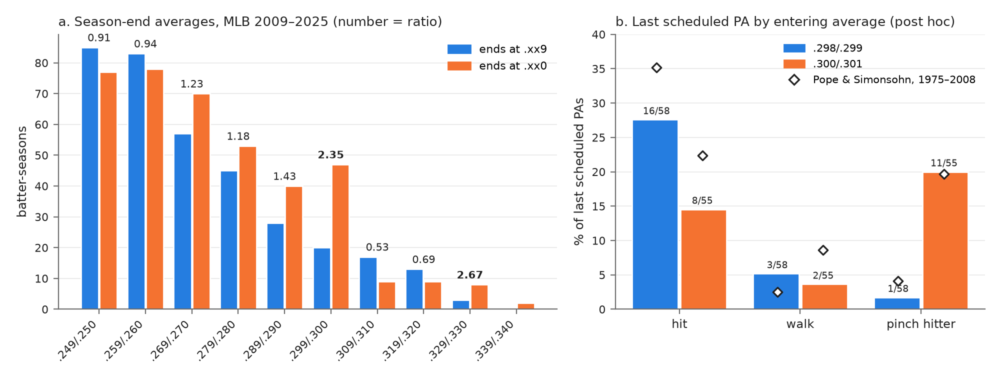

# The .300 hitter after 2008: a pre-registered held-out test of the round-number claims of Pope and Simonsohn

In baseball, a batting average of .300 is a famous mark of a good hitter. In 2011, Devin Pope and Uri Simonsohn showed that Major League batters of 1975–2008 were nearly 4 times as likely to end a season at exactly .300 as at .299. They also looked at the last plate appearance of the season. Batters at .299 never walked (0 of 61), and got more hits. Batters at .300 were often replaced by a pinch hitter, so that their average could not drop. The claim is often quoted as an example of round numbers as goals.

We re-tested the claims on the seasons 2009–2025, which were not in the original sample. We wrote down the tests before we computed any outcome. The data are the free Retrosheet play-by-play files.

- **Season-end excess (a re-test).** It persists, but it is smaller: 47 seasons end at .300 and 20 at .299 (ratio 2.35, one-sided p = 0.00065). An earlier study already found a smaller ratio for 2005–2018. Our pre-registered rule also asked that .300 beat 10 other thresholds; .330 gave a larger ratio (8 vs 3), so the claim is not supported under that rule.
- **No walks at .299.** Not seen again: 3 of 23 last plate appearances at .299 were walks.
- **More hits at .299.** Same direction, not significant: .421 against .200 (p = 0.125).
- **Pinch hitters at .300 (post hoc, exploratory).** Present: a pinch hitter took 30.0% of the last scheduled plate appearances at .300, against 5.7% at the other values from .280 to .320.

The post hoc substitution result and the descriptive exit check agree better with batters who stop at .300 than with batters who hit better below it.



*Left: batter-seasons that end at .xx9 (blue) and .xx0 (orange), MLB 2009–2025; the number is the ratio. Right: outcome of the last scheduled plate appearance (post hoc), with the 1975–2008 shares of the original paper (diamonds).*

Public data; computer-assisted; not yet reviewed by experts.

[Read the paper](paper/paper.pdf) · [LaTeX source](paper/paper.tex) · [Pre-registered protocol](PROTOCOL.md)

## Abstract

Pope and Simonsohn (2011) reported that Major League Baseball batters of 1975–2008 were nearly 4 times as likely to end a season at a .300 batting average as at .299. They also reported that in the last scheduled plate appearance of the season, batters at .299 never walked (0 of 61), got more hits, and were rarely replaced by a pinch hitter, while batters at .300 were often replaced. We re-tested these statements on the seasons 2009–2025, which were not in the original sample, with a protocol that we committed before we computed any outcome. The data are the public Retrosheet event files. Our parsed season totals agree with the MLB Stats API for 5,446 of 5,447 batter-seasons with at least 200 at-bats. The season-end excess at .300 is a re-test: three earlier studies re-tested it, and one already reports a smaller ratio for 2005–2018. The excess persists: 47 batter-seasons end at .300 and 20 at .299 (ratio 2.35, 95% CI 1.37–4.19; one-sided binomial p = 0.00065). The pre-registered rule also required the .300 ratio to exceed the ratio at 10 placebo thresholds, and it did not (.330: 8 vs 3). So this claim is not supported under the registered rule. The final-plate-appearance statements had no held-out test before. The zero count of walks at .299 does not persist (3 walks in 23 plate appearances), and we find no walk suppression (p = 0.89). The hit advantage at .299 has the paper's direction but is not significant (.421 vs .200, p = 0.125). In a post hoc, exploratory analysis with the paper's own definitions, the substitution pattern is present: a pinch hitter took 30.0% of the last scheduled plate appearances at .300 and 5.7% at the other values from .280 to .320 (Holm-adjusted p = 0.0002). The post hoc substitution result and the descriptive exit check agree better with batters who stop at .300 than with batters who hit better below it. This work has not yet been reviewed by experts. The computations and the text were produced by AI models (from Anthropic and OpenAI), working under the author's direction.

## Check it

With Python 3.10 or later and an internet connection, from this folder:

```sh
bash checks/ci.sh
```

The script installs scipy 1.18.1 with pip, downloads about 133 MB of raw files (17 Retrosheet event files, 17 MLB Stats API season files, the Chadwick register, two Lahman files), recomputes every number of the paper, and compares all of them with `data/expected.json`. It prints the numbers as JSON, then `MATCH expected.json`, and exits 0. On a Steam Deck (1 thread, fresh virtual environment, all downloads) the run took 125 s on 2026-11-28; expect about 2 to 5 minutes. See [checks/README.md](checks/README.md) for the details and for the independent recounts.

MLB can correct its records. A later download of the MLB Stats API can change the validation count, and the script then prints `MISMATCH expected.json`.

## Credits

Devin G. Pope and Uri Simonsohn published the claims. Paul Scott and Phil Birnbaum proposed the selection control. Kuninori Nakamura, Reio Tanji and Herm Krabbenhoft re-tested the season-end excess. Steve Lombardi noted Prince Fielder's 2011 walk at .299. Retrosheet supplied the play-by-play data. MLB Advanced Media publishes the Stats API. The Chadwick Baseball Bureau maintains the register and the Baseball Databank. Data sources and terms are in [THIRD_PARTY.md](THIRD_PARTY.md).

## Cite

```bibtex
@misc{WuRoundNumber300Hitters2026,
  author = {Wu, Qianghao},
  title  = {{The .300 hitter after 2008: a pre-registered held-out test of the round-number claims of Pope and Simonsohn}},
  year   = {2026},
  howpublished = {\url{https://github.com/KenWuqianghao/kenwu-lab/tree/main/results/round-number-300-hitters}}
}
```
