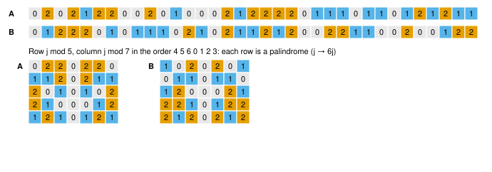

# A ternary Legendre pair of length 35

Take two sequences of length ℓ whose entries are cube roots of unity: 1, ξ = e^{2πi/3} and ξ². For a lag s, multiply each entry by the complex conjugate of the entry s places later (counted cyclically), and add the products. This sum is the periodic autocorrelation at lag s. The two sequences form a *ternary Legendre pair* when their two autocorrelations add up to −2 at every lag s ≠ 0. Such pairs give Butson Hadamard matrices, and they are the ternary form of the binary and quaternary Legendre pairs that are used to build Hadamard matrices.

Kotsireas, Liu and Winterhof ([arXiv:2611.31067](https://arxiv.org/abs/2611.31067), November 2026) proved that a ternary pair can exist only when ℓ ≡ −1 (mod 3). They found pairs for every such length up to 32, and conjectured that pairs exist for every such length. They named ℓ = 35 and ℓ = 38 as the smallest open cases.

**Result.** A ternary Legendre pair of length 35 exists. Here is one, with digit r for the entry ξ^r:

```
A = 02021220020100021222201110110121211
B = 01222010111021021121200221100200122
```

Both sequences stay the same when position j moves to position 6j (mod 35). In the grids below, row = j mod 5 and column = j mod 7; this symmetry makes each row read the same in both directions. The case ℓ = 38 remains open.



Proved in Lean; not yet reviewed by experts.

[Read the paper](paper/paper.pdf) · [LaTeX source](paper/paper.tex)

## Abstract

Kotsireas, Liu and Winterhof conjectured that ternary Legendre pairs exist for every length ℓ ≡ −1 (mod 3). They found ternary Legendre pairs for every such length ℓ ≤ 32 and named ℓ = 35 and ℓ = 38 as the smallest open cases. We give a ternary Legendre pair of length 35. This settles the case ℓ = 35. Both sequences of the pair are invariant under the multiplier j ↦ 6j (mod 35). We found the pair with an exact meet-in-the-middle search over the 42 042 000 sequences that have this symmetry and the required symbol composition. The search gives 2400 ordered pairs. Lean 4 with Mathlib checks the existence theorem, stated from the source's definition, with kernel evaluation and only the standard axioms. Two exact checkers in Python also accept the pair. The case ℓ = 38 remains open: our searches in some structured families of length 38 found no pair. This work has not yet been reviewed by experts. The computations, the proofs and the text were produced by AI models (from Anthropic and OpenAI), working under the author's direction.

## Check it

From this folder, with Python 3.10 or later (standard library only):

```sh
python3 -I checks/check.py
```

This takes less than 1 second. It checks the pair with two separate exact checkers, accepts the 8 pairs published in the source, rejects all 140 one-entry changes of our pair, and confirms that the Lean file holds the same pair.

The Lean proof, with [elan](https://github.com/leanprover/elan) and a Lean project on Mathlib tag v4.36.0 (Lean v4.36.0):

```sh
lake env lean lean/TernaryLP35.lean
```

Run it from the root of the Lean project, with the path to this file. It takes about 1 to 3 minutes after Mathlib is built. It prints `'exists_ternary_legendre_pair_35' depends on axioms: [propext, Classical.choice, Quot.sound]`.

The search, with a C compiler:

```sh
python3 -I checks/search.py 6       # about 1.5 minutes, 0.7 GB: 42042000 sequences, 2400 ordered pairs
python3 -I checks/search.py         # all 7 multiplier groups, about 7 minutes, up to 2.1 GB
bash checks/ci.sh                   # everything above except Lean, and a check of the numbers in the paper
```

Times are for one core of an Apple M1 Pro. The [checking guide](checks/README.md) explains each check.

## Credits

I. S. Kotsireas, H. Liu and A. Winterhof posed the question and supplied the definitions, the composition theorem and the integer test that our checks use ([arXiv:2611.31067](https://arxiv.org/abs/2611.31067)). The search with sequences fixed by a common multiplier group follows an idea that A. F. Ramos, D. B. Hulak and R. J. G. B. de Queiroz study for binary pairs of length 333 ([arXiv:2607.20765](https://arxiv.org/abs/2607.20765)). The Lean proof uses [Lean](https://github.com/leanprover/lean4) and [Mathlib](https://github.com/leanprover-community/mathlib4). The paper lists the other work on binary and quaternary Legendre pairs. Apache-2.0 (see the repository's LICENSE); [THIRD_PARTY.md](THIRD_PARTY.md) lists the third-party tools.

## Cite

```bibtex
@misc{WuTernaryLegendrePair35_2026,
  author       = {Wu, Qianghao},
  title        = {{A ternary Legendre pair of length 35}},
  year         = {2026},
  howpublished = {\url{https://github.com/KenWuqianghao/kenwu-lab/tree/main/results/ternary-legendre-pair-35}}
}
```
