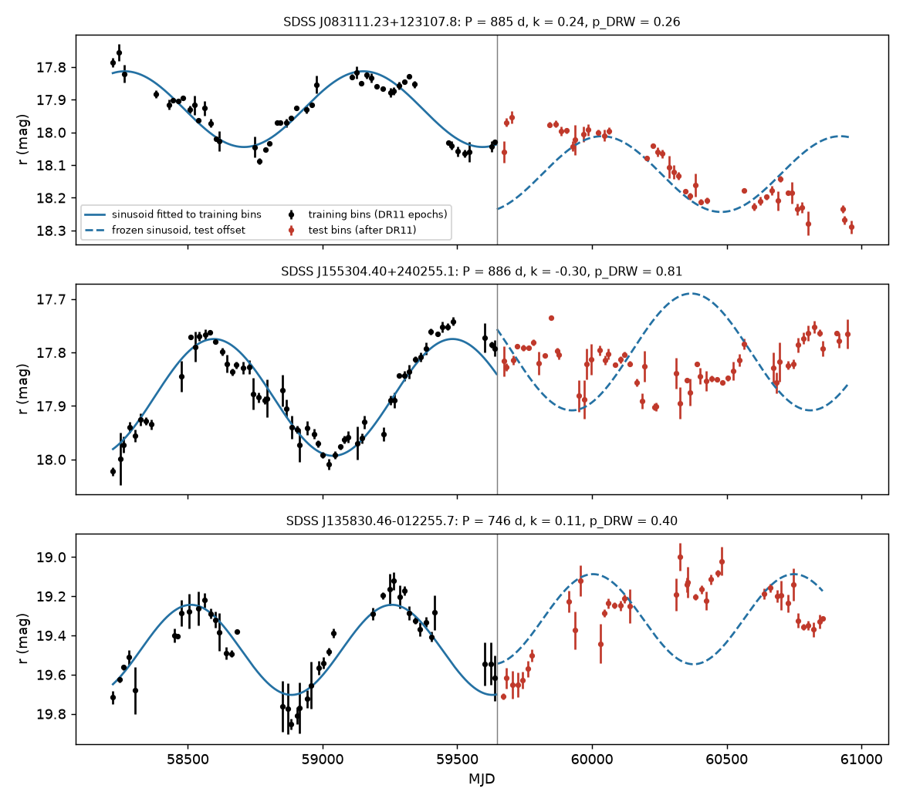

# A pre-registered forward test of 86 ZTF periodic-quasar candidates finds no predictive periodicity

A pair of supermassive black holes in a close orbit can make a quasar brighten and fade with a regular period. Survey searches look for such periods. But normal quasars also vary at random, with slow drifts, and a few years of random drifts can look like a sine wave. A real period continues. A chance pattern does not.

[Chen et al. (2024)](https://doi.org/10.1093/mnras/stad3981) found 86 quasars with sine-like variation in the Zwicky Transient Facility (ZTF) data up to its Data Release 11 (DR11). The authors already said that most of these may not be strictly periodic. ZTF has since observed the same quasars for 3.6 more years. We froze each candidate's sine wave on the DR11 data and checked whether it predicts the new data. We wrote down the test and the decision rule before we looked.

**Result.** The sine waves do not predict the new data better than random quasar variability does. 7 of 86 candidates pass the test at the 5% level. Chance gives 4.3. Quasars that were not selected for periodicity pass at a higher rate (29 of 273, 10.6%). None of the three candidates that Chen et al. found periodic also in older archival data passes. At most 14% to 36% of the candidates can be strict sine waves (95% confidence; the 36% figure is post hoc).



Public data; not yet reviewed by experts.

[Read the paper](paper/paper.pdf) · [LaTeX source](paper/paper.tex) · [Pre-registered protocol](PROTOCOL.md)

## Abstract

Chen et al. (2024) searched the ZTF DR11 light curves of 143,700 quasars and reported 86 candidates with significant sinusoidal variation against a single power-law red-noise model. Three of them still met the selection criteria in longer archival light curves. A stable sinusoid must continue after the data that found it. We froze the sinusoid of each candidate on the DR11 epochs and scored its prediction of the next 3.6 years of public ZTF r-band data (median 1.42 cycles). We wrote down the test, the controls and the decision rule before we computed any score. Each score was calibrated against damped-random-walk mocks that look at least as periodic as the candidate in the DR11 window. 7 of 86 candidates beat their mocks at p < 0.05, where chance gives 4.3 (binomial p = 0.139). 29 of 273 magnitude- and redshift-matched quasars that were not selected for periodicity do the same (10.6%; Fisher p = 0.81). None of the three named candidates is confirmed: their p-values are 0.26, 0.81 and 0.40. So we find no evidence that the candidate population continues as strict sinusoids. If all 86 were strict sinusoids at their fitted amplitude, simulations predict 65 passes. At 95% confidence, at most 14% of the candidates are strict sinusoids with the simulated power, or at most 36% with the lower power that we measured by injection into real quasar light curves (post hoc). The test does not exclude quasi-periodic signals, which Chen et al. already proposed as an explanation.

This work has not yet been reviewed by experts. The computations, the code and the text were produced by AI models (from Anthropic and OpenAI), working under the author's direction.

## Check it

Compare the committed summary with every number of the paper. This takes about 1 second and needs only Python 3:

```sh
python3 checks/rerun.py --compare
```

Rerun everything from the public data with Python 3.13. The script installs the pinned packages, downloads 430 ZTF light curves (about 90 MB) from IRSA, runs the analysis and compares every number of the paper and every per-object value with the committed files:

```sh
python3 -m venv .venv && . .venv/bin/activate
bash checks/ci.sh
```

It ends with `164/164 expected values reproduced`, `results_table.csv: 11868/11868 values reproduced` and `ci: all checks passed`. Run time on an 8-core M1 Pro with two analysis processes (`JOBS=2`): 45 min wall time, including the download (3,511 s CPU). By default the script uses one process per CPU core. [More detail](checks/README.md).

## Credits

Yong-Jie Chen and colleagues made the candidate list and wrote down how they made it, which made this test possible. The data come from the Zwicky Transient Facility through the NASA/IPAC Infrared Science Archive (IRSA), from the SDSS DR14 quasar catalogue and from the 2dF QSO Redshift Survey. The method follows the forward test of Gaia candidates by El-Badry, Hogg and Rix. [Data sources and licences](THIRD_PARTY.md). Apache-2.0 (see the repository's LICENSE).

## Cite

```bibtex
@misc{WuZtfPeriodicQuasarsHoldout2026,
  author       = {Wu, Qianghao},
  title        = {{A pre-registered forward test of 86 ZTF periodic-quasar candidates finds no predictive periodicity}},
  year         = {2026},
  howpublished = {\url{https://github.com/KenWuqianghao/kenwu-lab/tree/main/results/ztf-periodic-quasars-holdout}}
}
```
